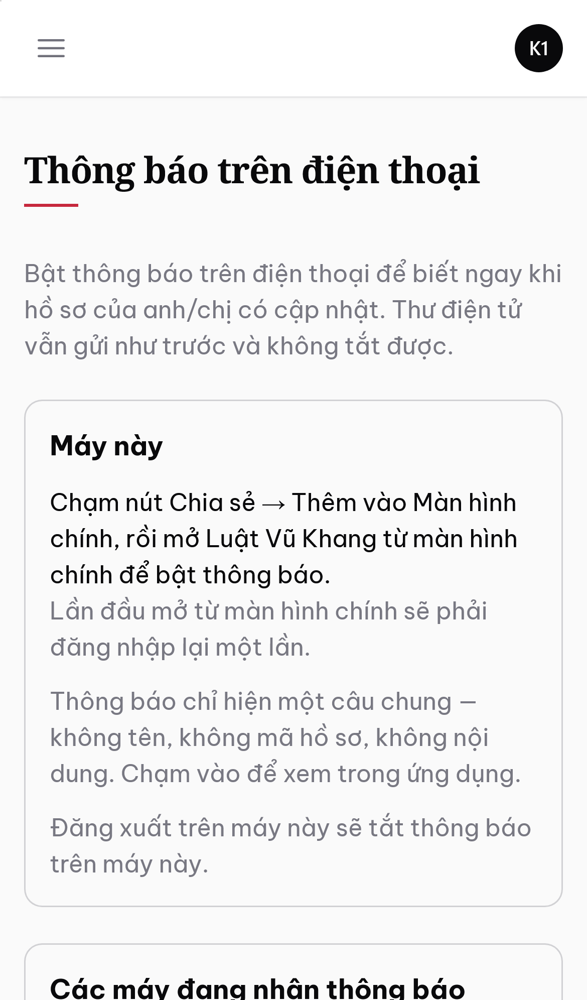
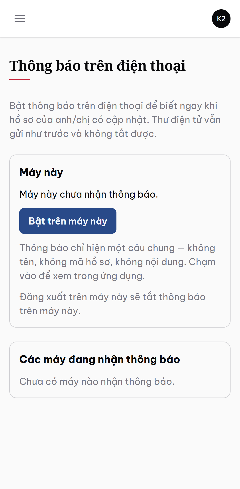
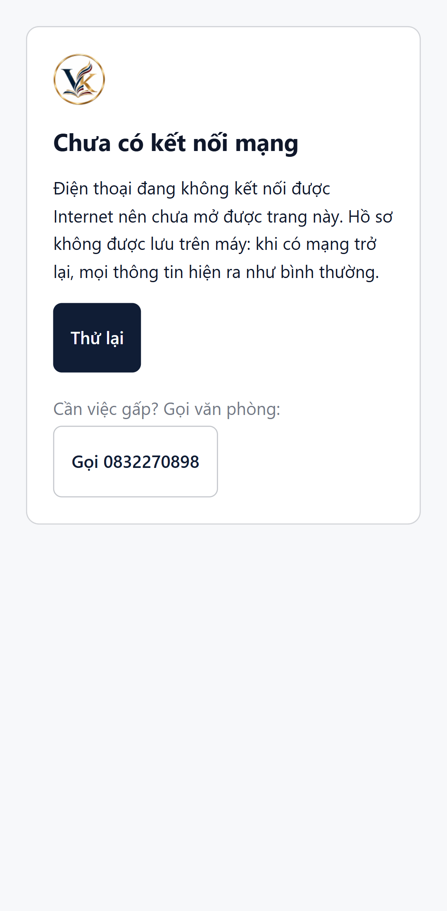

# VK-CRM — Quy trình chuẩn của văn phòng, và hệ thống đỡ ở chỗ nào

Tài liệu này là **một nguồn sự thật duy nhất về luồng nghiệp vụ**: từ lúc một người
lần đầu gọi tới văn phòng, cho tới lúc hồ sơ của họ được bàn giao và lưu trữ. Mỗi
bước ghi rõ ba thứ: **văn phòng làm gì**, **hệ thống đỡ bằng màn hình hay tác vụ
nào**, và **hiện đã có hay chưa**.

Rà soát đối chiếu mã nguồn ngày **2026-09-23**. Trạng thái ghi ở đây là thứ đo được
trong repo, không phải ý định.

**Cập nhật 2026-09-27 (M6.5 Task 21).** Đợt rà soát quy trình 2026-09-24
(`docs/audits/2026-09-24-quy-trinh.md`) chứng minh nhiều dòng **[Xong]** dưới đây chưa chạy thật
lúc ghi: không có màn hình gán đội ngũ, không có kiểm tra trùng khách, không có màn hình tra thư
đã gửi, 3/6 loại vụ việc không có danh mục để áp, và nhiều lỗi khác trên đường đi. Các dòng đó đã
được sửa trong M6.5; mỗi dòng ghi mã phát hiện và task đã sửa. Mọi task trừ Task 14 đã xong và qua
rà soát; **M6.5 chưa merge vào `main`** lúc viết (đang nghiệm thu). Chi tiết ở `docs/PROGRESS.md`,
"Ghi chú M6.5". Những gì vẫn chưa làm được sau M6.5 ghi rõ ở từng dòng, không để ẩn sau chữ
[Xong].

Ký hiệu: **[Xong]** đã chạy được và đã hợp nhất · **[Đang làm]** đã có mã, đang khép
lỗi · **[Có kế hoạch]** đã đặc tả chi tiết, chưa viết mã · **[Chưa có chủ]** chưa
thuộc kế hoạch nào.

---

## Giai đoạn 1 — Tiếp nhận và thẩm định đầu vào

Đây là giai đoạn quyết định nhiều tiền nhất và mang rủi ro nghề nghiệp cao nhất. Trước M10 hệ
thống không có chỗ nào cho nó; sau M10 mọi dòng dưới đây đã chạy được.

**Cập nhật 2026-10-03 (M10 Task 8).** Trạng thái đo trên nhánh `m10-intake` (mọi cổng xanh, ba luồng
nghiệm thu đi hết trên dữ liệu mẫu — `tests/Feature/Intake/IntakeAcceptanceWalkTest.php`); **M10 chưa
gộp vào `main`** lúc viết. Chi tiết, phán quyết và những gì còn chờ chủ văn phòng/luật sư xác nhận ở
`docs/PROGRESS.md`, "Ghi chú M10".

**Cập nhật 2026-10-04 (việc sau gộp M9 + M10).** M10 đã gộp vào `main` (`b2e02d7`, 2026-10-04): mọi dòng
**[Xong]** của giai đoạn này là trạng thái của `main`. Nâng một máy chủ đang chạy lên bản này:
`docs/CAI-DAT.md`, Bước 5, "Bản cập nhật M10 (tiếp nhận) làm gì trên máy chủ đã có dữ liệu" — đặc
biệt `db:seed --force` (thiếu nó thì menu Tiếp nhận không hiện với ai) và con số
`PROSPECT_RETENTION_MONTHS` phải được luật sư xác nhận TRƯỚC khi nhân sự bắt đầu ghi tiếp nhận.

**Cập nhật 2026-10-04 (rà soát cuối M10, vòng sửa 1).** Ba câu dưới đây từng hứa nhiều hơn hệ thống làm,
đã sửa cho đúng mã: "người nhập chỉ thấy mã hồ sơ và vai" (nay đúng với khớp Đỏ; khớp Vàng vẫn hiện tên
để người nhập tự xem), "người gọi lại cũng bị khoá" (chỉ khi cùng vai đã khai), "cùng số là cùng một
người" (chỉ là gợi ý).

| Văn phòng làm gì | Hệ thống đỡ bằng gì | Trạng thái |
|---|---|---|
| Ghi lại mỗi lần có người liên hệ, dù qua điện thoại, Zalo, website hay đến trực tiếp | Màn hình **Tiếp nhận**: trang tạo nhập nhanh (bắt buộc tên, vai dự kiến, nguồn, SĐT hoặc email; câu chuyện ghi sau), mã `TN-2026-0001` để nhắc qua điện thoại, nguồn có cả "form website" cho lead nhân sự nhập tay; giao người phụ trách; chuyển thành vụ việc không gõ lại (`ConvertIntakeToMatter` — khách tra theo CCCD rồi SĐT, mở vụ bằng đúng `OpenMatter`, phí đã báo thành gợi ý của hợp đồng) | **[Xong]** sau M10 (Task 1–4). Chưa có đường công khai: form trên luatvukhang.com gửi thẳng vào là một milestone riêng (R6) |
| **Kiểm tra xung đột lợi ích trước khi nghe nội dung vụ việc** | Lưu phần danh tính là chạy đúng `RunConflictCheck` (cùng khoá với mở vụ), dò khách và các bên của mọi vụ VÀ những người văn phòng đã nghe mà chưa nhận việc (lần tiếp nhận cũ — tối đa Vàng, "đã liên hệ văn phòng ngày …"). Ô câu chuyện: Xanh đủ định danh thì mở; Vàng hoặc thiếu định danh thì phải xác nhận đã xem các khớp; Đỏ thì khoá — chỉ trưởng phòng/quản trị từ chối hoặc ghi đè kèm lý do; Đỏ "dính" (sửa danh tính không gỡ được); một lần gọi khác của CÙNG người — cùng SĐT hoặc CCCD **và cùng vai đã khai** — cũng bị khoá như Đỏ, kể cả lần gọi đã ghi trước đó (khai vai khác thì lần gọi kia chỉ hiện ở mức Vàng, kèm mã `TN-…`). Danh sách có bộ lọc "Đỏ chờ trưởng phòng xử lý" để trưởng phòng/quản trị tìm những bản chỉ họ mở được | **[Xong]** sau M10 (Task 2, 3; rà soát cuối). Với khớp **Đỏ**, người nhập (không phải trưởng phòng/quản trị) chỉ thấy mã hồ sơ và vai của bên trùng — không tên, không lĩnh vực, không tiêu chí khớp. Với khớp **Vàng**, người nhập thấy mã hồ sơ, lĩnh vực, vai và tên bên trùng để tự xem trước khi xác nhận. Không ai thấy tiêu đề hay nội dung vụ ở đây |
| Phát hiện cùng một người gọi nhiều lần | Gợi ý bản ghi cũ khi trùng đúng SĐT (đã chuẩn hoá) hoặc CCCD — chỉ là gợi ý: một số máy có thể dùng chung (vợ chồng, người nhà, đồng nghiệp); trùng theo tên chỉ hiện cho trưởng phòng/quản trị; trùng một khách hàng thì chỉ nói "số này đã là khách của văn phòng"; người nhập hỏi lại cho chắc rồi mới gộp bản trùng vào bản cũ hơn | **[Xong]** sau M10 (Task 2, 3) |
| Bảo đảm không ai bị bỏ quên không gọi lại | Mốc phản hồi lần đầu (lần đầu rời "Mới"); quá 4 giờ làm việc (`INTAKE_RESPONSE_HOURS`) thì nhắc người được giao — không có thì trưởng phòng/quản trị, cuối cùng là admin — bằng chuông và thư không mang dữ liệu người liên hệ; widget "Liên hệ chưa ai gọi lại"; báo cáo "Bức tranh đầu vào" (nguồn, tỉ lệ thành vụ việc, thời gian phản hồi, lý do không thành) | **[Xong]** sau M10 (Task 5, 6). Ngày lễ chưa được trừ khỏi giờ làm việc và Thứ Bảy chưa tính — chờ chủ văn phòng |
| Từ chối vụ việc và ghi lý do | Nút "Từ chối" bắt buộc lý do; "vì xung đột lợi ích" chỉ trưởng phòng/quản trị chọn; lý do của mọi lần từ chối chỉ trưởng phòng/quản trị (và chính người đã từ chối) đọc được; người khác chỉ thấy "Văn phòng từ chối" và câu trả lời chuẩn — giống nhau cho mọi lý do, để không ai đoán ra lần nào là vì xung đột | **[Xong]** sau M10 (Task 3; rà soát cuối) |
| Giữ dữ liệu của người không thành khách đúng hạn, xoá khi họ yêu cầu | Ghi nhận người liên hệ đã nghe thông báo và đồng ý (ô không tích sẵn) trước khi ghi câu chuyện; hết `PROSPECT_RETENTION_MONTHS` (24) tháng thì tự ẩn danh; admin "Xoá dữ liệu theo yêu cầu" kèm lý do; câu chuyện không bao giờ ra máy chủ MCP | **[Xong]** sau M10 (Task 2, 7). Câu thông báo là BẢN NHÁP, con số 24 tháng và việc giữ dấu băm sau ẩn danh chờ luật sư xác nhận |

**Nhận một cuộc gọi đầu — từng bước cho người trực điện thoại** (M10):

1. **Tiếp nhận → Tạo.** Hỏi tên, số điện thoại (hoặc email), người gọi đứng ở vai nào (sẽ là người
   kiện, người bị kiện, hay người liên quan), và bên kia là ai — tên, kèm SĐT hoặc CCCD nếu người gọi
   biết. **Chưa hỏi chuyện gì đã xảy ra.**
2. **Đọc câu thông báo** hiện trên form cho người gọi. Người gọi đồng ý thì tích ô "đã nghe thông báo
   và đồng ý" (ô không bao giờ tích sẵn). Giao cho luật sư phụ trách nếu đã biết. Bấm Tạo — hệ thống
   kiểm tra xung đột lợi ích ngay lúc đó.
3. **Đọc kết quả trên trang bản ghi** (ngày giờ lần kiểm tra hiện ngay đó):
   - **Xanh** — ô câu chuyện mở: nghe và ghi câu chuyện.
   - **Vàng / thiếu định danh** — xem bảng khớp (mã hồ sơ, lĩnh vực, vai và tên bên trùng, hoặc "đã liên
     hệ văn phòng ngày …" kèm mã `TN-…`), bấm "Xác nhận đã xem các khớp" rồi mới nghe chuyện. Không chắc
     thì hỏi luật sư trước.
   - **Đỏ** (kể cả "Đỏ chờ trưởng phòng xử lý") — **dừng, không nghe chuyện.** Bảng chỉ cho anh/chị mã
     hồ sơ và vai của bên trùng. Hẹn sẽ gọi lại, báo trưởng phòng/quản trị. Họ quyết: từ chối (vì xung
     đột) hoặc ghi đè kèm lý do. Lần gọi khác của cùng người — cùng số (hoặc CCCD) và **cùng vai** —
     cũng bị khoá như vậy, cả lần gọi lại hôm sau lẫn một lần gọi đã ghi từ trước. Nếu lần gọi lại khai
     vai KHÁC, hệ thống chỉ hiện lần gọi kia ở mức Vàng kèm mã `TN-…`: thấy mã một lần gọi trước của
     cùng số thì báo trưởng phòng trước khi nghe chuyện.
4. **Hệ thống báo đã có bản ghi cũ cùng số** — RẤT CÓ THỂ là cùng một người, nhưng một số máy có thể
   dùng chung (vợ chồng, người nhà, đồng nghiệp): hỏi lại cho chắc. Đúng người thì gộp bản mới vào bản
   CŨ hơn (đồng hồ phản hồi chạy theo bản còn lại); không phải thì để hai bản riêng.
5. **Gọi lại và đổi trạng thái** (Đã liên hệ → Đang tư vấn → Đã báo giá, ghi phí đã báo). Lần đầu đổi
   trạng thái là mốc "đã phản hồi"; quá 4 giờ làm việc mà bản ghi còn "Mới" thì hệ thống nhắc.
6. **Khách đồng ý:** luật sư bấm "Chuyển thành vụ việc" (trợ lý không có nút này) — hệ thống tìm khách
   cũ theo CCCD/SĐT, hỏi xác nhận đúng người, mở vụ có mã, phí đã báo hiện sẵn ở form soạn hợp đồng.
   **Không thành:** "Khách không theo tiếp", hoặc "Từ chối" kèm lý do. Từ chối vì xung đột thì chỉ nói
   với người gọi **"Văn phòng xin phép không nhận vụ việc này"**, không giải thích thêm.
7. **Dữ liệu người không thành khách** tự ẩn danh sau hạn lưu. Ai yêu cầu xoá: báo admin, admin dùng
   "Xoá dữ liệu theo yêu cầu" và ghi cách đã xác minh người yêu cầu. Bản sao lưu cũ còn dữ liệu cho tới
   khi bị dọn — 30 bản đêm gần nhất, cộng khoảng 30 ngày trong Thùng rác của Google Drive: thường
   khoảng hai tháng, lâu hơn nếu có đêm sao lưu bị lỡ (`docs/SAO-LUU-KHOI-PHUC.md`).

**Nhân viên kinh doanh chăm sóc lead — từng bước** (bổ sung 2026-10-14, vai "Nhân viên kinh doanh"; SPEC
§5, bổ sung cùng ngày). Tài khoản có chức danh **Nhân viên kinh doanh** làm việc ở mục **Tiếp nhận**, với
những lead mình ghi hoặc được giao (ngoài ra chỉ có bảng tin, hồ sơ cá nhân, thiết bị nhận thông báo và
danh mục loại vụ việc để đọc); không thấy vụ việc, hồ sơ khách, tài liệu, tiền, không trang Tìm kiếm,
không báo cáo toàn văn phòng.

1. **Ghi lead** như người trực điện thoại (bước 1–3 ở trên). Kết quả kiểm tra xung đột hiện cho anh/chị
   **chỉ mức** Xanh/Vàng/Đỏ — không mã hồ sơ, không tên ai. Vàng hoặc Đỏ: **chưa nghe nội dung vụ việc**,
   bấm **"Chuyển cho luật sư"** và hẹn khách sẽ có luật sư gọi lại. Vàng thì luật sư xem các khớp và quyết.
   **Đỏ thì chỉ trưởng phòng/quản trị xử lý được** (từ chối, hoặc ghi đè kèm lý do) — luật sư cũng không,
   và cũng chỉ thấy mã hồ sơ và vai của khớp Đỏ — nên chuyển thẳng cho trưởng phòng, hoặc báo trưởng phòng.
   Xanh mà chỉ thiếu SĐT/CCCD của bên kia thì tự bấm "Xác nhận đã xem các khớp" được.
2. **Mỗi lần liên hệ lại khách** (gọi, Zalo, email, gặp) bấm **"Ghi lần chăm sóc"** trên trang lead: kênh,
   thời gian, một câu ngắn về việc đã làm ("đã gửi báo phí qua Zalo"), và **hẹn liên hệ lại** nếu có. Không
   ghi nội dung vụ việc ở đây. Đổi trạng thái (Đã liên hệ → Đang tư vấn → Đã báo phí) bằng nút "Đổi trạng
   thái" như trước — ghi lần chăm sóc không tự đổi trạng thái.
3. **Trang chủ** của anh/chị có ba khối: **"Lead của tôi"** (số lead theo trạng thái), **"Lead đến hẹn liên
   hệ lại"** (hẹn hôm nay hoặc đã qua), **"Liên hệ chưa ai gọi lại"**. Trên cả ba là dải **"Tình trạng hệ
   thống"** khi lịch chạy tự động hay sao lưu có chuyện — dải đó mọi nhân sự đều thấy.
4. **Khi khách cần tư vấn chuyên môn hay sắp ký:** "Chuyển cho luật sư" — chọn một luật sư (hoặc trưởng
   phòng). Luật sư nhận thông báo, thấy lead, kiểm tra lại xung đột và **mở vụ** ("Chuyển thành vụ việc" —
   nhân viên kinh doanh không có nút này). Anh/chị vẫn thấy và chăm sóc lead; khi lead thành vụ việc, trang
   lead chỉ ghi "Đã chuyển thành vụ việc". Riêng khi vụ mở ra có mức bảo mật **"Hạn chế"**, anh/chị
   **không còn thấy lead** nữa: nó rời danh sách và khối "Lead của tôi", mở đường dẫn cũ thì ra "không tìm
   thấy" — vụ hạn chế chỉ người được xem vụ đó mới biết là có. Đó không phải lỗi.
5. **Trưởng phòng/quản trị** thấy mọi lead, và trên trang **"Bức tranh đầu vào"** có khối **"Lead theo người
   phụ trách"**: mỗi người (nhân viên kinh doanh, trợ lý, luật sư) nhận bao nhiêu lead trong kỳ và bao nhiêu
   đã thành vụ việc. Lead tính cho người được giao; chưa giao ai thì cho người đã ghi.

**Luật nghề nghiệp đứng sau giai đoạn này.** Nếu nghe hết câu chuyện rồi mới phát
hiện bên kia là khách hàng hiện hữu thì thông tin bí mật đã nghe rồi và không rút lại
được. Vì vậy kiểm tra xung đột đứng **trước** phần nội dung, không phải sau. Và khi
từ chối vì xung đột, nói lý do thật cho người gọi chính là tiết lộ rằng có tồn tại
một khách hàng khác.

---

## Giai đoạn 2 — Mở hồ sơ

| Văn phòng làm gì | Hệ thống đỡ bằng gì | Trạng thái |
|---|---|---|
| Tạo khách hàng, kiểm tra trùng | Resource `Client`, số định danh mã hoá khi lưu; trùng số điện thoại/CCCD thì cảnh báo kèm liên kết hồ sơ trùng, phải xác nhận mới tạo được bản thứ hai | **[Xong]** sau M6.5 — trước đó không có kiểm tra trùng nào (`intake/intake-07`); sửa ở Task 6. Form khách vượt độ dài cột thành lỗi 500 trên MariaDB (`intake-08`), sửa ở Task 6. Dò trùng theo tên và theo người gọi lại vẫn là việc của M10 |
| Mở vụ việc, sinh mã không bao giờ đổi | `OpenMatter`, mã dạng `VK-2026-DD-0147`; luật sư tra khách đúng số điện thoại/CCCD hoặc tạo khách mới ngay trong form; sửa được vụ sau khi mở, huỷ được vụ mở nhầm | **[Xong]** sau M6.5 — trước đó luật sư không mở được vụ cho khách mới (`intake-03`, `roles/roles-04`; Task 6, R4) và vụ không sửa được sau khi mở (`intake-06`, `spec-gap/spec-gap-06`; Task 5) |
| Chạy kiểm tra xung đột trước khi nhận | `RunConflictCheck` hiện ngay trong biểu mẫu tạo; kết quả Đỏ phải có lý do ghi đè | **[Xong]** sau M6.5 — rà soát tìm: khách quay lại luôn ra vàng với chính hồ sơ cũ, hai khách của văn phòng đối nhau vẫn ra xanh, ghi đè một lần rồi chặn mãi, sửa định danh khách không ai được báo, hai người mở hai vụ đối nhau cùng lúc cùng ra xanh (`conflict/conflict-01`–`04`, `06`, `07`, `11`, `12`); sửa ở Task 8 (R13) |
| Khai các bên trong vụ việc | Tab **Các bên**; thêm, sửa, gỡ một bên (gỡ là xoá mềm kèm lý do); mỗi lần đều chạy lại kiểm tra xung đột | **[Xong]** sau M6.5 — trước đó không sửa hay gỡ được bên đã nhập, số điện thoại viết kiểu `(+84) 912 345 678` bị từ chối (`conflict-05`, `09`, `10`); sửa ở Task 9 (R14) |
| Giao luật sư phụ trách và đội ngũ | Tab **Đội ngũ**: thêm, gỡ luật sư phối hợp, trợ lý, người theo dõi; đổi luật sư phụ trách qua **Bàn giao**; phạm vi nhìn thấy suy từ đội ngũ | **[Xong]** sau M6.5 — trước đó **không có màn hình nào** thêm người vào đội ngũ: mọi vụ chỉ có luật sư phụ trách, trợ lý không bao giờ thấy vụ (`intake/intake-01`, `roles/roles-03`, `spec-gap/spec-gap-01`, `e2e/F4`, critical); sửa ở Task 3 (R6), bàn giao một vụ ở Task 4 (R7) |
| Áp danh mục giấy tờ theo loại vụ việc | `ApplyChecklistTemplate`, màn hình quản lý danh mục mẫu trên loại vụ việc, nút thêm đầu mục cho một vụ, thanh tiến độ `X/Y` | **[Xong]** sau M6.5 — trước đó không có màn hình danh mục mẫu nào và 3/6 loại vụ việc mở ra với danh mục rỗng, khách không nộp được giấy tờ (`intake/intake-02`, `checklist/checklist-02`, `roles/roles-06`, `spec-gap/spec-gap-04`, critical; Task 15); thanh `X/Y` đếm nhầm văn bản văn phòng phát hành (`checklist-05`; Task 17, SPEC §4.10) |
| Ký hợp đồng dịch vụ, chốt giá trị và các đợt thu | Tab **Hợp đồng và thanh toán** trên trang vụ việc: luật sư phụ trách bấm "Soạn hợp đồng" (một giá trị, thuế suất nếu có, các đợt theo phần trăm hoặc số tiền), rồi "Kích hoạt" khi khách đã ký — tổng các đợt lệch một đồng thì không kích hoạt được. Hợp đồng giấy đã ký mà luật sư chưa nhập thì **kế toán nhập** ở trang **Hợp đồng** (xem "Kế toán nhập hợp đồng", Giai đoạn 5) | **[Xong]** M9; kế toán nhập: làn kt (2026-10-15) |

---

## Giai đoạn 3 — Xử lý vụ việc

| Văn phòng làm gì | Hệ thống đỡ bằng gì | Trạng thái |
|---|---|---|
| Chuyển giai đoạn, viết cập nhật cho khách | Biểu mẫu chuyển giai đoạn có phần xem trước đúng thứ khách sẽ đọc; vào giai đoạn kết thúc thì vụ được đóng (`closed_at`) | **[Xong]** sau M6.5 — trước đó tab Tiến độ vỡ vĩnh viễn sau lần cập nhật đầu trên vụ chưa bật cổng (`e2e/F1`, critical; Task 1), máy chủ thư chết thì luật sư gặp lỗi 500 (`stage/stage-01`; Task 11), không chỗ nào ghi `closed_at` (`stage-03`; Task 5), bấm hai lần sinh hai dòng (`stage-05`; Task 10) |
| Ghi chú nội bộ không bao giờ lộ ra ngoài | Ghi chú nội bộ tách khỏi nội dung công bố, chặn ở ba lớp | **[Xong]** |
| Nhận giấy tờ khách nộp, duyệt hoặc từ chối kèm lý do | Tab **Danh mục hồ sơ**, duyệt ngay trên dòng; một lần nộp nhiều trang là một phiên bản; duyệt gắn với đúng những tệp người duyệt đã thấy | **[Xong]** sau M6.5 — trước đó giấy nhiều trang nộp từng tệp làm trang trước biến mất, và tệp đến lúc hộp xác nhận đang mở vẫn được nhận (`checklist-03`, `04`; Task 17, R10, R11). Khách nhận thư báo khi giấy tờ bị từ chối (M6). Sửa sai (sửa sau kiểm tra nghiệp vụ 2026-10-09): đưa một đầu mục lỡ bấm "Không cần nộp"/"Đã nhận" về "Còn thiếu", sửa tên, mô tả, "bắt buộc" của một đầu mục cho riêng vụ, và — khi khách gửi thêm vào giấy đã nhận — "Từ chối bản mới, giữ bản đã nhận" (không thư từ chối, gói bàn giao mang bản đã nhận) |
| Lưu tài liệu theo bốn nhóm, nhóm nội bộ không bao giờ hiện cho khách | Tab **Tài liệu**, nhóm D nền khác màu và không có nút công bố; văn bản nhóm B đi trình duyệt → đã ký, đã nộp → công bố | **[Xong]** sau M6.5 — trước đó văn bản nhóm B **không bao giờ công bố được** vì không có đường tới `signed_filed` (`docs/docs-1`, critical), và đổi nhóm B → C vượt được vòng đời (`docs-2`); sửa ở Task 16 (R9). Rút lại một tài liệu đã công bố: nút **Rút lại** kèm lý do khách đọc được (M7 Task 7); rút bản hiện tại của một đầu mục nhóm A thì đầu mục về "Còn thiếu" (hoặc về bản đã nhận trước đó). Sửa tiêu đề, ngày ban hành, đầu mục; **Xoá** tài liệu tải nhầm mà khách chưa từng thấy, bắt nhập lý do (sửa sau kiểm tra nghiệp vụ 2026-10-09) |
| **Đặt mốc thời hạn tố tụng** | Tab **Mốc thời hạn**: thêm nhanh, đổi người phụ trách, quá hạn và hết hạn hôm nay tô đỏ, còn dưới bảy ngày tô vàng, đã xong thì xám | **[Xong]** 2026-09-23 — **sửa và xoá một mốc** (phiên toà hoãn) chưa có lúc rà soát (`deadlines/F7`), đang hoàn tất ở M6.5 Task 14; widget "Mốc thời hạn 7 ngày tới" trên trang chủ (`F5`, `spec-gap-05`) cũng ở Task 14 |
| Được nhắc trước khi tới hạn, theo bậc | Tác vụ `CheckDeadlines` 07:00 hằng ngày, bậc 14/7/3/1 ngày và quá hạn; thư qua hàng đợi, người nhận là người được xem vụ | **[Xong]** (M6 Task 6, trên `main` từ 2026-09-23) và sửa ở M6.5 — một hộp thư lỗi dừng cả lượt nhắc và mất nhật ký (`deadlines/F1`, `notify-2`, critical; Task 11), thư vụ hạn chế gửi tới người không được xem (`F2`; Task 12), người phụ trách bị khoá thì mốc im lặng (`F4`; Task 4, 12). Thông báo cảnh báo quá hạn trong hệ thống (`F6`) đang hoàn tất ở Task 14 |
| **Ghi lại cuộc gọi, buổi làm việc với khách** | Tab **Liên lạc**, ghi một cuộc gọi trong dưới 15 giây | **[Xong]** M7 Task 8 (`CommunicationLogsRelationManager`) |
| Biết hồ sơ nào đang đứng im quá lâu | Cảnh báo 14 ngày trong hệ thống, 21 ngày gửi thư cho quản lý | **[Xong]** M6 (`StaleMattersWidget`, `CheckStaleMatters` + thư `StaleMatterReminder`) |
| Bàn giao khi luật sư nghỉ việc mà không rơi mốc hạn nào | `ReassignMatter` cho một vụ: đổi luật sư phụ trách, chuyển mốc chưa xong và yêu cầu khách chưa đóng; không cho vô hiệu hoá hay xoá người còn giữ việc | **[Xong]** cho từng vụ (M6.5 Task 4, R7, kéo lên từ M7). **[Xong]** M7: màn hình bàn giao hàng loạt (`BulkReassign`, chỉ vụ đang mở) và thư tổng hợp cho người nhận (`MatterReassigned`) |
| Khoá NGAY một nhân sự nghỉ đột xuất hoặc bị nghi lộ dữ liệu, khi người đó còn giữ việc | Quản trị viên mở trang sửa nhân sự, bấm **Khoá truy cập ngay** (lý do ít nhất 20 ký tự): đăng xuất mọi phiên, vô hiệu cookie ghi nhớ, thu hồi mọi kết nối AI, gỡ mọi máy nhận thông báo, ghi nhật ký. Việc dở dang giữ nguyên để bàn giao sau: vụ, mốc hạn, yêu cầu khách qua Bàn giao hàng loạt; lead tiếp nhận đang mở (được chuyển tư vấn, đang phụ trách — hộp xác nhận đếm cả hai) qua "Chuyển cho luật sư" hoặc ô "Người phụ trách" trên từng lead, vì Bàn giao hàng loạt không chuyển lead; mở lại bằng công tắc "Đang hoạt động". Không khoá được chính mình hay quản trị viên đang hoạt động cuối cùng | **[Xong]** sửa sau kiểm tra 2026-10-09 (làn fb) |

### Tìm tài liệu (làn tl, chủ văn phòng 2026-10-15)

Mục **Tài liệu** trên thanh bên trái (nhóm **Khách hàng & vụ việc**, ngay dưới Vụ việc) liệt kê **mọi tài liệu bạn được phép xem, của mọi vụ việc**, mới
nhất ở trên. Dùng nó khi nhớ tên tài liệu, mã hồ sơ hay tên khách mà không nhớ vụ nào:

- **Tìm** theo tên tài liệu, mã hồ sơ hoặc tên khách. **Lọc** theo vụ, loại vụ, nhóm (A–D), trạng thái,
  người tải lên (kể cả "khách hàng nộp qua cổng"), khoảng ngày tải lên, và "Vụ của tôi" (vụ mình phụ
  trách, hoặc vụ có tên mình trong đội).
- **Tải về** ngay trên dòng (cùng đường tải, cùng sổ ghi ai tải như nút "Tải tệp" trong vụ), hoặc **Mở vụ**
  để tới tab Tài liệu của vụ đó. Tải lên, sửa, công bố, rút lại, chuyển nhóm, xoá vẫn **chỉ** làm ở tab
  Tài liệu của từng vụ.
- **Ai thấy gì** — đúng luật của tab Tài liệu: quản trị viên thấy mọi vụ; trưởng phòng mọi vụ thường;
  luật sư và trợ lý vụ có tên mình trong đội; vụ **hạn chế** chỉ luật sư phụ trách và quản trị viên (có
  tên trong đội cũng không đủ). Nhóm D (nội bộ) chỉ người được đọc nhóm D — trợ lý không. Kế toán và nhân
  viên kinh doanh không có mục này. Tài liệu đã xoá, tài liệu của vụ đã xoá hay đã ghi quyết định tiêu
  huỷ không hiện. Tài liệu không được xem thì không có mặt ở đâu trên trang: không trong số đếm, kết quả
  tìm, hay danh sách chọn vụ của bộ lọc.
- Trang **Tìm kiếm** vẫn tìm **vụ việc** theo tiêu đề tài liệu (và mã, tên khách, các bên…), cùng luật
  quyền; trang Tài liệu là nơi tìm **chính tài liệu**.
- Trang **Kho tài liệu** (chỉ quản trị viên) là trang kỹ thuật: tài liệu đang lưu ở máy chủ hay Google
  Drive, kho có chạy ổn không, các bước bật Google Drive. Không dùng trang đó để tìm tài liệu.

---

## Giai đoạn 4 — Khách hàng theo dõi

| Khách làm gì | Hệ thống đỡ bằng gì | Trạng thái |
|---|---|---|
| Đăng nhập an toàn trên điện thoại | Mật khẩu cộng mã một lần qua email, khoá sau năm lần sai theo cả tài khoản lẫn địa chỉ mạng; văn phòng mở khoá được | **[Xong]** sau M6.5 — trước đó ô "Ghi nhớ đăng nhập" cho vào lại 400 ngày không cần mật khẩu lẫn mã (`portal/portal-1`), khách bị xoá vẫn đăng nhập được (`portal-3`), và văn phòng không có cách mở khoá (`portal-4`); sửa ở Task 2 và 7 (R12) |
| Xem danh sách hồ sơ của mình | Màn hình danh sách, một hồ sơ thì vào thẳng trang tiến độ | **[Xong]** |
| Xem hồ sơ đang ở giai đoạn nào, sắp tới làm gì | Trang tiến độ bảy khối, viết cho người không học luật, có tóm tắt cho khách | **[Xong]** sau M6.5 — "Tóm tắt cho khách" trước đó không hiện ở đâu (`portal-2`; Task 5) |
| Biết còn thiếu giấy tờ gì và nộp bằng ảnh chụp | Màn hình nộp giấy tờ, chụp thẳng từ điện thoại, một lần nộp nhiều trang | **[Xong]** sau M6.5 — trước đó 3/6 loại vụ việc không có đầu mục nào để nộp (`checklist-02`; Task 15) và giấy nhiều trang bị ghi đè từng trang (`checklist-03`; Task 17) |
| Đọc lý do khi giấy tờ bị từ chối và nộp lại | Lý do hiện nguyên văn, bản nộp lại nối vào bản cũ | **[Xong]** — khách nhận thư báo khi giấy tờ bị từ chối (M6) và đọc lý do trên cổng. Gửi thêm vào một giấy văn phòng ĐÃ NHẬN thì cổng nói rõ và hỏi xác nhận trước (sửa sau kiểm tra nghiệp vụ 2026-10-09) |
| Hỏi lại văn phòng và nhận trả lời | Yêu cầu từ khách, trả lời theo luồng; hộp thư văn phòng sắp theo hoạt động gần nhất | **[Xong]** phần hỏi và trả lời trên màn hình. **Còn thiếu:** văn phòng **không được báo** khi khách gửi yêu cầu mới hay hỏi tiếp, nhân sự phải tự mở tab Yêu cầu của từng vụ (`requests/REQ-1`, `REQ-2`); khách không được báo khi văn phòng trả lời (`REQ-4`). Cả ba chuyển sang M6 Task 4 |
| Nhận thư báo khi có cập nhật mới | Bốn mẫu thư cho khách, chỉ chứa nội dung đã công bố | **[Xong]** M6 (`StageUpdate`, `DocumentPublished`, `DocumentRejected`, `RequestAnswered`; cộng `MissingDocuments`). Dòng tiến độ công bố nhầm rút được khỏi cổng ("Rút khỏi cổng", làn fm 2026-10-09); thư đã gửi thì không thu hồi được |
| Nhận thông báo trên điện thoại, chạm một lần là mở đúng hồ sơ | Ứng dụng cài từ trình duyệt (không qua chợ ứng dụng), thông báo đẩy đi cùng bốn thư của khách, màn hình khoá chỉ hiện một câu chung | **[Đang làm]** M12 — đã có mã, chờ gộp và chờ chủ văn phòng thử trên iPhone, Android thật; hướng dẫn cài ở mục cuối tài liệu này |
| **Xem đã đóng bao nhiêu trên tổng giá trị hợp đồng** | Khối **Hợp đồng và thanh toán** trên trang tiến độ của cổng: số hợp đồng, tổng giá trị, thuế suất, ngày ký, từng đợt (đến hạn khi nào, đã thanh toán, còn lại, quá hạn) và các khoản văn phòng đã nhận. Không hiện ghi chú nội bộ, lý do miễn/huỷ, người ghi, khoản thu đã huỷ, bản nháp hay hợp đồng đã huỷ. Đợt theo tiến độ chưa tới bước của nó nói "đến hạn khi vụ việc tới bước …" bằng nhãn cho khách; tới bước đó thì đổi thành ngày đến hạn. Gói bàn giao in cùng bảng kê đó | **[Xong]** M9 Task 10 — chủ văn phòng đã quyết: **khách xem được** (phán quyết P1, 2026-09-24). Thư về tiền gửi khách chỉ có khi bật công tắc "Nhắc lịch thanh toán cho khách" (mặc định tắt) — xem mục cùng tên |

Văn phòng nhìn ngược lại: mỗi dòng đã công bố mang nhãn **khách đã xem lúc nào**, và
dòng chưa ai xem quá năm ngày thì nhắc luật sư gọi điện.

---

## Giai đoạn 5 — Tiền

| Văn phòng làm gì | Hệ thống đỡ bằng gì | Trạng thái |
|---|---|---|
| Chốt một giá trị hợp đồng duy nhất | Tab **Hợp đồng và thanh toán** của vụ (luật sư, trưởng phòng, quản trị viên), hoặc trang **Hợp đồng** của kế toán cho hợp đồng giấy đã ký (xem "Kế toán nhập hợp đồng" bên dưới): một hợp đồng cho một vụ, giá trị là số khách trả (đã gồm thuế nếu có); bản nháp sửa thẳng được; từ lúc kích hoạt, đổi giá trị hay lịch thu chỉ bằng **Ký phụ lục** (lý do, ngày ký, giá trị cũ và mới được giữ lại, không sửa, không xoá); bản nháp chưa có khoản thu thì xoá được | **[Xong]** M9 |
| Chia thành các đợt thu gắn vào tiến độ | Mỗi đợt đến hạn theo một trong ba cách: khi ký hợp đồng, vào một ngày cụ thể, hoặc **khi vụ việc tới một giai đoạn** ("thu đợt hai 15 ngày sau khi nộp đơn khởi kiện") — luật sư chuyển giai đoạn là đợt đó có ngày đến hạn ngay, tính từ ngày giai đoạn thật sự xảy ra; một lượt đối chiếu 07:00 hằng ngày bắt nốt những đợt lỡ | **[Xong]** M9 (Task 4, 6) |
| Ghi từng khoản tiền thật sự nhận, ai ghi, nhận bằng cách nào | Trang **Công nợ** của kế toán (xem "Kế toán ghi tiền" bên dưới); người ghi, ngày tiền về, cách nhận, mã giao dịch/số biên lai; ghi nhầm thì **huỷ** kèm lý do, khoản đã huỷ vẫn nằm đó | **[Xong]** M9 (Task 5, 8) |
| Được nhắc khi một đợt quá hạn | Thư nội bộ 08:00 hằng ngày: ngày đầu quá hạn, rồi bảy ngày một lần, tới kế toán và luật sư phụ trách (vụ hạn chế: luật sư phụ trách và quản trị viên). Hệ thống không TỰ gửi thư đòi nợ quá hạn cho khách — xem "Nhắc lịch thanh toán cho khách" bên dưới | **[Xong]** M9 Task 11 |
| Nhìn bức tranh tiền: đã thu trên tổng, còn phải thu | Trang **Doanh thu** (nhóm **Tài chính** của menu trái). Trên cùng là một hàng bốn ô số lớn, đọc trong một giây: **Đã thu** (tiền về trong kỳ), **Còn phải thu** và **Quá hạn** (tính tại hôm nay, không theo kỳ — bấm vào mở trang Công nợ, ô Quá hạn đã lọc sẵn, với người mở được trang đó), **Hợp đồng ký mới** (số hợp đồng và tổng giá trị ký trong kỳ); ô Đã thu và ô ký mới có mũi tên ▲/▼ so với cùng khoảng của kỳ liền trước. Dưới đó là các biểu đồ: vành khuyên đã thu / còn phải thu / quá hạn, doanh thu theo thời gian, theo đợt/giai đoạn, cơ cấu theo 12 lĩnh vực, tải theo luật sư, hồ sơ đã kết thúc còn công nợ. Trục và nhãn của biểu đồ ghi tiền gọn ("60 tr", "1,2 tỷ"); rê chuột lên biểu đồ thấy số đầy đủ. Mỗi ô, mỗi biểu đồ chỉ có một tiêu đề ngắn; cách tính (theo ngày ký hay ngày tiền về, theo luật sư lúc thu hay luật sư hiện tại) nằm sau nút **ⓘ** cạnh tiêu đề — bấm để đọc. Bộ lọc kỳ, luật sư, lĩnh vực gọn một hàng trên đầu trang | **[Xong]** M9 Task 9; gọn lại ở làn rv (2026-10-15) |
| Không đóng hồ sơ nhầm khi còn công nợ | Đóng vụ việc không bị chặn (vụ đã kết thúc còn nợ hiện trên trang Doanh thu, bộ lọc "Đã kết thúc, còn công nợ" của trang Công nợ và dải cảnh báo trên tab tiền), nhưng xoá vụ, huỷ vụ mở nhầm hay xoá khách hàng thì bị chặn khi còn hợp đồng đang hiệu lực có dư nợ | **[Xong]** M9 |

### Sửa sai và thay đổi trên một hợp đồng đã ký (sửa sau kiểm tra 2026-10-09, làn fb)

Mọi thao tác dưới đây ở tab **Hợp đồng và thanh toán** của vụ, cần lý do ít nhất 20 ký tự và để lại
một dòng trong nhật ký hệ thống.

- **Khách xin khất một đợt:** bấm **Dời hạn** trên dòng của đợt còn chờ thu, chọn ngày đến hạn mới.
  Số tiền và trạng thái giữ nguyên; công nợ, nhắc quá hạn và cổng khách đọc theo ngày mới. Đợt theo
  giai đoạn chưa tới giai đoạn thì chưa có ngày để dời.
- **Miễn nhầm một đợt:** bấm **Bỏ miễn** trên dòng đó, **trước khi hoàn tất hợp đồng** — đợt quay
  lại chờ thu theo đúng hạn cũ. Hợp đồng đã hoàn tất (hoặc đã huỷ) thì không bỏ miễn được nữa; miễn
  đợt chưa thu cuối cùng là hoàn tất được ngay, nên kiểm tra kỹ trước khi bấm **Hoàn tất**. Modal
  **Miễn** nay ghi rõ tên đợt, giá trị, số đã thu và phần sẽ thôi đòi trước khi xác nhận.
- **Ký lại hợp đồng với điều khoản mới, hoặc kích hoạt nhầm khi khách chưa ký:** **Huỷ hợp đồng**
  (modal ghi rõ số còn phải thu sẽ không còn được theo dõi), rồi bấm **Soạn hợp đồng mới**. Hợp đồng
  đã huỷ và các khoản đã thu của nó ở lại làm lịch sử (một dòng "Hợp đồng trước của vụ" ở đầu tab);
  lịch thu, công nợ, nhắc quá hạn và khối tiền trên cổng khách theo hợp đồng mới. Một vụ không bao
  giờ có hai hợp đồng chưa huỷ cùng lúc.
  - **Tiền đã thu trên hợp đồng đã huỷ:** hợp đồng mới **chỉ ghi phần còn phải thu**. Tiền đã thu
    trên hợp đồng đã huỷ vẫn tính doanh thu (trang Doanh thu, P7) — **không ghi lại** khoản đó trên
    hợp đồng mới, nếu không doanh thu bị tính hai lần. Ngược lại, ghi hợp đồng mới đủ giá trị cũ thì
    cổng khách và trang Công nợ (chỉ đọc hợp đồng hiện hành) báo khách còn nợ nhiều hơn thực tế.
    Modal **Soạn hợp đồng mới** (và **Nhập hợp đồng** ở trang Hợp đồng của kế toán) hiện sẵn số đã thu
    trên hợp đồng đã huỷ để trừ ra.

### Kế toán nhập hợp đồng (làn kt, chủ văn phòng chọn 2026-10-15)

Hồ sơ vẫn do luật sư hoặc trưởng phòng mở. Khi hồ sơ đã có mà chưa có hợp đồng (khách ký giấy, luật sư
chưa kịp nhập), kế toán nhập số tiền của hồ sơ — không cần, và không được, mở nội dung hồ sơ.

1. Kế toán mở **Hợp đồng** (menu trái, nhóm **Tài chính**; hoặc nút **Nhập hợp đồng cho hồ sơ** đầu trang Công nợ, hoặc ô
   "Hồ sơ chưa có hợp đồng" trên trang chủ). Trang mặc định chỉ hiện hồ sơ **chưa có hợp đồng** và hợp
   đồng **còn nháp**; mỗi dòng có mã hồ sơ, loại vụ việc, tên khách hàng, luật sư phụ trách, số và trạng
   thái hợp đồng, tổng giá trị, đã thu, còn phải thu — **không** có tiêu đề, ghi chú, tài liệu hay các
   bên. Kế toán không thấy vụ hạn chế ở đây (vụ hạn chế chỉ hiện với quản trị viên và luật sư phụ trách
   vụ đó). Tìm theo mã hồ sơ hoặc tên khách; lọc theo loại vụ việc, luật sư.
2. Bấm **Nhập hợp đồng** trên dòng đó, điền đúng như tờ hợp đồng: tổng giá trị (đã gồm thuế nếu có,
   gõ `50.000.000`), thuế suất, từng đợt (tên, phần trăm **hoặc** số tiền, đến hạn khi ký / vào một ngày /
   khi vụ tới một giai đoạn). Khung xem trước cho thấy số tiền từng đợt và tổng các đợt so với giá trị.
   Số hợp đồng `HD-năm-số` do hệ thống cấp.
   Hồ sơ có hợp đồng **đã huỷ** (lọc trạng thái "Đã huỷ"): hộp thoại hiện sẵn số đã thu trên hợp đồng đã
   huỷ — chỉ nhập **phần còn phải thu**, không ghi lại khoản đã thu ("Tiền đã thu trên hợp đồng đã huỷ" ngay trên).
3. Khách **đã ký** và tổng các đợt khớp giá trị: bật **Khách đã ký — kích hoạt luôn**, chọn ngày ký
   (không ở tương lai), rồi bấm **Lưu và kích hoạt** — hợp đồng đang hiệu lực ngay, đợt "khi ký" có hạn.
   Lệch tổng một đồng thì không lưu gì, hộp thoại giữ nguyên để sửa. Chưa chắc: để công tắc tắt — nút
   đổi thành **Lưu nháp**, bấm **Lưu nháp**, rồi **Sửa bản nháp** / **Kích hoạt (đã ký)** / **Xoá bản
   nháp** trên cùng dòng khi đã rõ.
4. Luật sư phụ trách nhận một dòng chuông "Kế toán … đã nhập hợp đồng … — anh/chị kiểm tra lại." (luật sư
   phụ trách đã nghỉ thì các trưởng phòng nhận thay; người nhập không bao giờ nhận chuông của chính mình). Từ lúc
   kích hoạt, mọi thay đổi điều khoản (phụ lục, huỷ, miễn, dời hạn, thư nhắc khách) là việc của luật sư
   hoặc trưởng phòng ở tab **Hợp đồng và thanh toán** — kế toán kích hoạt nhầm thì báo luật sư huỷ rồi
   nhập lại.
5. Tiền về: nút **Ghi khoản thu** trên dòng của hợp đồng đang hiệu lực mở trang Công nợ lọc sẵn mã hồ sơ
   (xem "Kế toán ghi tiền" ngay dưới).

Máy chủ đang chạy cần chạy lại `php artisan db:seed --force` sau bản cập nhật này để vai kế toán có quyền
mới `contract.enter` (docs/CAI-DAT.md, "Nâng cấp lên bản mới").

### Kế toán ghi tiền

1. Kế toán mở **Công nợ** (menu trái). Trang chỉ có mã hồ sơ, loại vụ việc, tên khách hàng, tên
   đợt, các con số và các ngày — **không** có tiêu đề vụ việc, tài liệu hay tiến độ; vụ hạn chế
   không có trên trang này (chỉ luật sư phụ trách và quản trị viên thấy và ghi tiền của nó).
2. Tìm đợt khách vừa trả: bộ lọc "Quá hạn", "Đến hạn trong 7 ngày", "Đã kết thúc, còn công nợ"
   và "Khách hàng".
3. Bấm **Ghi khoản thu** trên dòng đó: số tiền (gõ `1.250.000` — dấu chấm là phân cách nghìn, không
   nhận số lẻ), ngày tiền về (không được ở tương lai), cách nhận, mã giao dịch hoặc số biên lai.
   Thu một phần là bình thường; thu vượt số còn lại của đợt thì bị từ chối kèm số còn thiếu — phần
   dư không tự dồn sang đợt sau (muốn đổi lịch thu thì luật sư ký phụ lục). Thu đủ thì đợt tự sang
   "đã thu đủ".
4. Ghi nhầm: **Huỷ khoản thu** trên dòng của đợt (chọn khoản cần huỷ), hoặc — khi đợt đã thu đủ và
   không còn trong bảng — ở mục **Khoản thu gần đây** cuối trang. Mục này mặc định chỉ có khoản thu
   có ngày tiền về trong **90 ngày** gần nhất; khoản cũ hơn (như khoản ghi lùi ngày lúc nhập hợp đồng
   cũ, xem mục dưới) thì mở bộ lọc của mục, **gõ mã hồ sơ** vào ô "Mã hồ sơ" rồi **bấm "Áp dụng bộ
   lọc"**: mục hiện mọi khoản thu chưa huỷ của hồ sơ đó, cũ đến đâu cũng vậy. Gõ xong mà chưa bấm thì
   danh sách chưa đổi. Lý do ít nhất 20 ký tự. Khoản đã huỷ không bị xoá, chỉ ra khỏi mọi
   tổng; trạng thái đợt lùi lại đúng như trước. Hợp đồng đã hoàn tất thì không huỷ khoản thu được.
   Vụ hạn chế không có trên trang của kế toán: quản trị viên huỷ ở chính mục này (khoản cũ hơn 90
   ngày: cũng gõ mã hồ sơ rồi bấm "Áp dụng bộ lọc"); luật sư phụ trách huỷ trên tab **Hợp đồng và
   thanh toán** của vụ: nút **Huỷ khoản thu** ở đó cũng có ô chọn đúng khoản (ngày tiền về, số tiền,
   cách nhận, mã giao dịch, lúc ghi), mặc định là khoản **ghi vào hệ thống gần nhất** — không phải
   khoản có ngày tiền về muộn nhất (sửa sau kiểm tra 2026-10-09, làn fb).
5. Doanh thu của một khoản thu tính cho **luật sư phụ trách lúc tiền về**; bàn giao vụ sau đó không
   dời khoản đã thu sang người mới (phần còn phải thu thì theo người mới).

Không có ô tải bản scan biên lai ở trang này (đã chọn giữ `mã giao dịch / số biên lai`, M9 Task 8);
bản scan, nếu cần lưu, tải lên tab Tài liệu của vụ ở nhóm "Chỉ nội bộ".

### Nhắc lịch thanh toán cho khách (công tắc, mặc định TẮT — chủ văn phòng 2026-10-10)

Mọi thứ trong mục này chỉ chạy khi **công tắc đang BẬT**. Tắt (mặc định) thì hệ thống chạy đúng như
trước: chỉ nhắc nội bộ cho nhân sự, khách không nhận thư nào về tiền.

**Bật, tắt ở đâu.** Quản trị viên mở **Nhắc thanh toán cho khách** (menu trái): công tắc,
số ngày báo trước hạn (1–30, mặc định 3) và thông tin chuyển khoản của văn phòng (ngân hàng, số tài
khoản, chủ tài khoản, chi nhánh). Phải điền đủ thông tin chuyển khoản mới bật được, và không bật được
trên tài khoản giả của dữ liệu mẫu ("TAI KHOAN THU NGHIEM"); quét mã QR xem thử trên trang bằng ứng
dụng ngân hàng trước khi bật. Mỗi lần đổi có một dòng trong Nhật ký hệ thống (ai, lúc nào). Tắt là có hiệu lực ngay, kể cả với thư đã xếp hàng mà chưa đi: thư đó **không** được gửi.

**Khách nhận gì khi công tắc bật.**

- Trên cổng khách, trang hồ sơ có thêm phần **Lộ trình thanh toán**: giá trị hợp đồng, đã thanh toán,
  còn lại, thông tin chuyển khoản, và với mỗi đợt đã có ngày hạn mà còn phải trả — số tiền, **nội dung
  chuyển khoản** (`MÃ-HỒ-SƠ DOT n`, để kế toán nhận ra tiền của hồ sơ nào) và mã QR điền sẵn số tiền.
- **Thư xác nhận đã nhận tiền** mỗi khi văn phòng ghi một khoản thu (huỷ khoản thu thì không gửi gì):
  số tiền, ngày nhận và số còn phải trả theo hợp đồng (hay "đã thanh toán đủ"). Hợp đồng bị huỷ trước
  khi thư kịp đi thì thư chỉ xác nhận khoản đã nhận, không nói gì về số còn lại.
- **Thư báo trước hạn**, mỗi sáng 08:15: đợt còn phải trả có ngày hạn từ hôm nay tới hết số ngày báo
  trước. Mỗi đợt một thư cho mỗi tài khoản — chạy lại hay đổi số ngày không gửi lại; văn phòng **Dời
  hạn** đợt sang ngày khác thì khách được báo một lần nữa cho ngày mới. Thư có tên đợt, số tiền còn phải
  trả, ngày hạn, thông tin chuyển khoản, nội dung chuyển khoản và mã QR (khi máy chủ có extension `gd`).
  Đợt "theo giai đoạn" chưa tới giai đoạn thì chưa có ngày hạn nên không được báo.
- Người nhận: tài khoản cổng **đang hoạt động và đã kích hoạt** của khách, và chỉ khi vụ còn hiện trên
  cổng của họ (vụ chưa công bố hay đã hết hạn tra cứu thì không ai nhận). Vụ **hạn chế**: thư chỉ nêu
  mã hồ sơ và mời đăng nhập cổng, không nêu số tiền.

**Đợt quá hạn — không tự gửi cho khách; người quản lý hợp đồng quyết.** Thư nhắc nội bộ 08:00 cho kế
toán và luật sư giữ nguyên. Muốn nhắc khách thì luật sư trong đội của vụ, quản lý hoặc quản trị viên
(kế toán không) mở tab **Hợp đồng và thanh toán** của vụ, bấm **Gửi thư nhắc** trên dòng của đợt quá hạn:
hộp thoại cho **xem trước** đúng thư sẽ gửi — người nhận, số tiền còn phải trả, ngày hạn, tiêu đề và nội
dung — rồi bấm **Gửi thư**. Mỗi đợt **một lần mỗi ngày** (bấm lần thứ hai trong ngày thì hệ thống báo giờ
và người đã gửi). Mỗi lần gửi để lại một dòng ở tab **Liên lạc** của vụ và một dòng trong Nhật ký hệ
thống: ai gửi, lúc nào, gửi cho những địa chỉ nào. Kết quả từng thư (đã đi hay lỗi) xem ở tab **Thư đã
gửi**; thư lỗi hẳn thì người đã bấm nhận chuông báo để liên hệ khách bằng kênh khác. Khách vừa trả đủ
hay đợt vừa được dời hạn trước khi thư kịp đi thì thư không đi.

**Thử trên bản xem thử.** Dữ liệu mẫu có sẵn tài khoản chuyển khoản rõ là giả ("TAI KHOAN THU NGHIEM"),
một đợt sắp đến hạn của khách `khach1@example.com` và nhiều đợt quá hạn. Trên máy dev bật công tắc ngay
được, rồi bấm **Gửi thư nhắc** trên một đợt quá hạn — thư hiện trong hộp thư thử Mailpit sau khoảng một phút (lượt xử lý hàng
đợi). Muốn thấy ngay thư báo trước hạn thay vì đợi 08:15:
`bin/dev artisan schedule:test --name=client-payments.due-soon`. Trước khi dùng thật, thay tài khoản giả
bằng tài khoản thật của văn phòng: ngoài máy dev (`APP_ENV=local`) hệ thống không cho bật công tắc trên tài
khoản giả, và chạy lại dữ liệu mẫu không bao giờ ghi đè thông tin chuyển khoản đã cấu hình.

### Nhập hợp đồng đang chạy khi bắt đầu dùng hệ thống

Văn phòng bắt đầu dùng hệ thống khi đã có những hợp đồng ký từ trước, khách đã trả một phần, vụ
việc đã đi được nửa đường. Nhập chúng như sau (phép đo:
`tests/Feature/Actions/Billing/GoLiveImportScenarioTest.php`):

1. **Đưa vụ tới giai đoạn hiện tại bằng MỘT lần chuyển ghi lùi ngày** (quản trị viên bỏ qua được thứ
   tự giai đoạn), ngày xảy ra là ngày thật vụ vào giai đoạn đó. Hệ thống chỉ có đúng một dòng tiến
   độ: vào giai đoạn hiện tại. **Các giai đoạn trước đó không có dòng nào.**
2. **Soạn hợp đồng với ngày ký thật** và lịch thu thật, theo luật:
   - đợt của **giai đoạn đã qua** (ví dụ "khi nộp đơn" trên một vụ đã được toà thụ lý) nhập là
     **đến hạn vào một ngày cụ thể** — ngày đã hẹn thật. Nhập nó là "khi vụ tới giai đoạn nộp đơn"
     thì nó **không bao giờ đến hạn**: không có dòng tiến độ nào vào bước đó, và lượt đối chiếu hằng
     ngày chỉ đọc dòng tiến độ có thật;
   - đợt của **giai đoạn hiện tại** để "khi vụ tới giai đoạn" được: lần chuyển ở bước 1 là lần chạm
     của nó, hạn tính từ ngày ghi ở bước 1 (không sớm hơn ngày ký);
   - đợt của **giai đoạn chưa tới** để "khi vụ tới giai đoạn" như bình thường.
3. **Kích hoạt** với ngày ký thật. Đợt khi ký và đợt của giai đoạn hiện tại có ngày đến hạn ngay —
   nhiều khi đã qua.
4. **Kế toán ghi lùi ngay các khoản khách đã trả** (ngày tiền về thật). Làm trong cùng buổi, trước
   08:00 hôm sau: đợt nào đã qua hạn mà chưa ghi tiền thì là "quá hạn" thật trên trang Doanh thu,
   trang Công nợ, cổng khách và thư nhắc 08:00 — hệ thống không phân biệt được "chưa thu" với
   "đã thu mà chưa nhập". Ghi nhầm (sai đợt, sai ngày, sai số tiền) thì huỷ rồi ghi lại cho đúng:
   khoản ghi lùi hơn 90 ngày **không hiện** ở mục **Khoản thu gần đây** của trang Công nợ cho tới khi
   **gõ mã hồ sơ** vào ô "Mã hồ sơ" của bộ lọc mục đó **rồi bấm "Áp dụng bộ lọc"** — gõ mà chưa bấm thì
   danh sách chưa đổi (xem "Kế toán ghi tiền", bước 4; vụ hạn chế: quản trị viên hoặc luật sư phụ trách
   huỷ).
5. Kiểm: trang Doanh thu, kỳ chứa ngày ký — lát "Quá hạn" phải đúng bằng số khách thật sự còn nợ
   quá hạn (thường là 0); `php artisan billing:check-invariants` sạch.

---

## Giai đoạn 6 — Kết thúc, bàn giao, lưu trữ

| Văn phòng làm gì | Hệ thống đỡ bằng gì | Trạng thái |
|---|---|---|
| Sinh gói bàn giao cho khách | Tệp nén nhóm A/B/C kèm mục lục PDF và toàn bộ tường trình tiến độ, không bao giờ lẫn tài liệu nội bộ; nhóm A là đúng bản văn phòng đã nhận của từng đầu mục | **[Xong]** M7 Task 4/11 — gói tự sinh khi vụ vào giai đoạn kết thúc (sinh lại bằng nút trên trang vụ), ở trạng thái chưa công bố: luật sư xem rồi công bố cho khách; khoá khi hồ sơ đã ghi quyết định tiêu huỷ (làn fm 2026-10-09) |
| Cho khách tải về từ cổng, có hạn | Quyền tra cứu hết sau 90 ngày mặc định kể từ khi vụ kết thúc, dữ liệu vẫn nguyên bên trong | **[Xong]** M7 Task 5. Hạn hiện ở khối "Lưu trữ hồ sơ" của trang vụ; luật sư phụ trách hoặc quản trị viên gia hạn được, có lý do và nhật ký (làn fm 2026-10-09) |
| Giữ hồ sơ theo chính sách lưu trữ | Hạn lưu trữ mặc định 10 năm, hệ thống **cảnh báo chứ không bao giờ tự xoá**; quyết định tiêu huỷ được ghi lại | **[Xong]** M7 Task 6 (`FlagRetentionExpiry`, "Ghi quyết định tiêu huỷ") |
| Tìm lại một hồ sơ cũ bằng bất cứ thứ gì nhớ được | Trang **Tìm kiếm** (ô tìm kiếm sáu nguồn), kết quả luôn đi qua phân quyền | **[Xong]** M7 (trang `Search`) |

---

## Theo dõi đội ngũ — giao ban hằng tuần và đánh giá hằng tháng (M13)

Hai câu hỏi khác nhau, hai trang khác nhau. Đừng đặt số của trang này cạnh số của trang kia: "12 vụ đang
mở" (bây giờ) và "80% đúng hạn" (tháng trước) không cùng một thời điểm.

| Văn phòng làm gì | Hệ thống đỡ bằng gì | Trạng thái |
|---|---|---|
| **Giao ban hằng tuần:** ai đang giữ gì, việc nào đang nguy hiểm, phải gọi ai trước | Trang **Theo dõi đội ngũ** (trưởng phòng, quản trị viên): mỗi luật sư, trợ lý một dòng, số tính ngay lúc mở — vụ đang phụ trách, vụ quá hạn cập nhật cho khách, mốc quá hạn, mốc 7 ngày tới, yêu cầu của khách chờ trả lời, giấy tờ chờ duyệt, mức hoàn thiện danh mục. Sắp xếp theo cột đếm việc tồn (mốc quá hạn trước) để biết gọi ai trước; số > 0 ở mốc quá hạn và quá hạn cập nhật tô đỏ. Bấm tên để mở **trang của người đó**: danh sách vụ, mười mốc và mười yêu cầu gấp nhất, giấy tờ chờ duyệt, cơ cấu lĩnh vực, biểu đồ 90 ngày. Công tắc "Gồm người đã nghỉ việc" khi cần bàn giao nốt | **[Xong]** M13 |
| **Đánh giá hằng tháng:** trong tháng trước mỗi người đã làm đúng hạn tới đâu | Trang **Hiệu suất theo kỳ**, kỳ mặc định **tháng trước** (kỳ đã đóng: làm nốt việc sau kỳ không làm đẹp số của kỳ). Mốc đúng hạn/trễ/lỡ tính cho người giữ mốc **vào ngày đến hạn**, yêu cầu của khách tính cho người giữ luồng **lúc trả lời** — người nhận bàn giao không gánh việc người trước đã lỡ. Mốc đã gỡ và yêu cầu đóng không trả lời ở cột riêng, để tỉ lệ không đẹp lên nhờ gỡ mốc hay đóng luồng. Dưới 5 việc thì không tính tỉ lệ. Dòng "Chung — các vụ bạn được xem" đứng đầu để so một người với cả văn phòng. Khối "Cách tính các con số" nói từng số được tính thế nào | **[Xong]** M13 |
| Luật sư, trợ lý tự xem số của mình | Mục **Việc của tôi** (trang của chính mình) và dòng của chính mình trên "Hiệu suất theo kỳ" — cùng bảng "Cách tính" như trưởng phòng. Kế toán không thấy trang nào trong ba trang; doanh thu theo luật sư vẫn ở trang Doanh thu | **[Xong]** M13 |
| Vụ hạn chế truy cập không lộ ra qua con số | Mọi số tính trên các vụ người xem được xem; trưởng phòng và luật sư phụ trách có thể thấy hai con số khác nhau cho cùng một người — đúng thiết kế | **[Xong]** M13 |

**Vì sao không có bảng xếp hạng** — bốn lý do, cũng in trên trang "Hiệu suất theo kỳ":

1. **Cơ cấu vụ khác nhau.** Luật sư hình sự có nhiều mốc dày, khách khó liên lạc; luật sư doanh nghiệp ít
   mốc. So thẳng tỉ lệ của hai người là so hai loại việc. Cột "Lĩnh vực chính" cho biết mỗi tỉ lệ thuộc bối
   cảnh nào.
2. **Mẫu nhỏ.** Văn phòng vài chục người, mỗi người vài chục mốc một quý: hai điểm phần trăm chênh nhau là
   nhiễu.
3. **Xếp hạng dạy người ta lách số** — bấm "hoàn thành" sớm, gỡ mốc khó, tránh nhận vụ khó.
4. **Vai trò khác nhau.** Trợ lý và luật sư không làm cùng loại việc.

Hệ thống không tự làm gì dựa trên các con số này (không khoá, không nhắc, không đổi quyền), không gửi thư
tổng hợp, và ghi nhật ký mỗi lần một người mở số của người khác. Đây là dữ liệu cá nhân của nhân sự: việc
thông báo cho nhân sự là câu hỏi cho luật sư của văn phòng (`docs/PROGRESS.md`, "Ghi chú M13").

---

## Giao – nhận – xử lý nội bộ: hồ sơ và công việc (làn tk)

Mọi lần giao trong văn phòng đều có người nhận xác nhận, có người theo dõi, và không rơi vào khoảng trống
khi ai đó bận, nghỉ hay rời vụ. Hai thứ được giao: **một hồ sơ** (một chỗ trong đội ngũ của vụ việc) và
**một việc** (một đầu việc cụ thể, có hạn hoặc không). Chỉ trong nội bộ — khách không bao giờ thấy.

**Nhận hồ sơ.**

1. Luật sư phụ trách hay trưởng phòng thêm một người vào **tab "Đội ngũ"** của vụ (luật sư cộng sự, trợ
   lý), hoặc **bàn giao** vụ cho một luật sư phụ trách mới (nút "Bàn giao", hay "Bàn giao hàng loạt" khi
   một người nghỉ việc). Người nhận được báo bằng chuông — bàn giao hàng loạt là **một** chuông cho cả lô
   ("Anh/chị được bàn giao n hồ sơ", kèm mã các hồ sơ), đi cùng thư tổng hợp bàn giao, không một chuông mỗi
   hồ sơ.
2. Người nhận mở **Việc của tôi**: khối **"Hồ sơ chờ tôi nhận"** có hai nút ngay trên dòng —
   **"Đã nhận hồ sơ"** (một cú bấm) hoặc **"Trả lại"** kèm lý do (đang quá tải, xung đột lợi ích…). Cùng hai
   nút có trên dòng của chính họ ở tab "Đội ngũ". Quản trị viên không có mục Việc của tôi: một người được đổi
   chức danh sang Quản trị viên khi còn hồ sơ chờ nhận thì chuông, thư nhắc và thư bàn giao dẫn thẳng tới tab
   "Đội ngũ" của hồ sơ đó, và họ bấm trên dòng của mình ở đó.
3. **Trả lại không gỡ ai khỏi vụ.** Người giao (nếu còn theo dõi hồ sơ), luật sư phụ trách và người quản lý
   hồ sơ (trưởng phòng; với hồ sơ hạn chế truy cập là quản trị viên, vì trưởng phòng không mở được hồ sơ đó)
   nhận chuông và thư kèm lý do; tab "Đội ngũ" và trang **Theo dõi đội ngũ** hiện "cần phân công lại". Người đã
   trả lại hồ sơ không nhận được việc mới của hồ sơ đó, và việc họ còn giữ trên hồ sơ hiện "Cần giao lại".
   Người quản lý xử lý bằng các nút sẵn có: gỡ người đó khỏi đội ngũ và thêm người khác, hoặc bàn giao vụ cho
   luật sư khác. Lý do trả lại chỉ
   hiện cho người quản lý được đội ngũ và chính người trả lại.
4. Người theo dõi (vai "Người theo dõi") và người tự thêm chính mình không phải bấm nhận. Các thành viên đã
   có trước khi tính năng này chạy coi như đã nhận.

**Giao việc.** Trong tab **"Công việc"** của vụ (luật sư phụ trách, luật sư cộng sự, trưởng phòng), hay bằng nút
**"Giao việc"** đầu trang **Công việc** (từ 2026-10-16: mọi luật sư, trợ lý, trưởng phòng, quản trị viên — không kế
toán, không kinh doanh). Trên trang Công việc, ô **"Vụ việc"** để trống là một **việc chung** (không thuộc vụ nào —
ví dụ tra cứu trước buổi tư vấn một khách tiềm năng, cập nhật mẫu hợp đồng), giao được cho bất kỳ nhân sự nào đang
làm việc; chọn một vụ (chỉ các vụ đang mở anh/chị được giao việc) thì người nhận là người trong đội ngũ của vụ đó.
Ô "Giao cho" ghi bên tên mỗi người số việc họ đang giữ và số việc quá hạn — chỉ đếm việc anh/chị xem được (nhãn
ghi "… việc anh/chị thấy được", và câu gợi ý dưới ô nhắc người đó có thể còn giữ việc trên hồ sơ khác) — để cân khối
lượng trước khi giao. Ghi việc cần làm, đặt hạn và mức ưu tiên. Bấm "Giao việc" hai lần trên cùng một hộp
thoại (mạng chậm) chỉ tạo một việc; mở hộp thoại lần nữa để giao một việc khác cùng tên thì là hai việc. Dòng đầu
trang Công việc nhắc luật sư, trợ lý, trưởng phòng: hồ sơ chờ nhận nằm ở mục **Việc của tôi** (quản trị viên, kế
toán, kinh doanh không có mục đó — dòng đầu trang chỉ nói trang chứa gì); tab "Chờ tôi nhận" trống mà anh/chị còn hồ
sơ chờ nhận thì trang chỉ đúng chỗ đó. Người nhận bấm **"Đã nhận"** hoặc **"Trả lại"** kèm lý do, rồi
**"Hoàn thành"** (ghi chú kết quả tuỳ chọn). Người giao theo dõi ở tab **"Tôi đã giao"**: việc bị trả lại
cần **"Giao lại"** hoặc **"Huỷ việc"**. Việc hiện **"Cần giao lại"** (cột "Người nhận" ghi lý do; bật bộ lọc
"Cần giao lại" ở tab "Tất cả") khi người nhận đã nghỉ, đã rời đội ngũ vụ, đã trả lại chính hồ sơ đó, hay không
còn mở được hồ sơ (ví dụ đổi chức danh sang Kế toán hay Nhân viên kinh doanh) — việc đó đã biến khỏi danh
sách của họ, nên luật sư phụ trách hay trưởng phòng giao lại. (Hồ sơ không đổi được sang hạn chế truy cập khi
còn người trong đội ngũ sẽ không mở được nó.) Việc bị trả lại mà người giao đã nghỉ hay không còn mở được hồ sơ cũng vậy (cột "Người
giao" ghi lý do). Trên một vụ đã kết thúc, người giao không sửa hay giao lại được việc còn mở nữa — chỉ còn
huỷ; người nhận vẫn bấm "Đã nhận", "Trả lại" hay "Hoàn thành" được (ví dụ việc thu dọn cuối hồ sơ). Người
nhận một việc "Cần giao lại" vì chính họ (đã sang "Người theo dõi", rời đội ngũ, trả lại hồ sơ, không còn mở
được hồ sơ) không bấm "Đã nhận" hay "Hoàn thành" được nữa — chỉ còn "Trả lại". Hộp thoại
kết thúc vụ liệt kê số việc nội bộ còn mở và số người chưa nhận hồ sơ, cùng các việc còn dở khác.

**Sửa, giao lại, huỷ — người liên quan đều được báo** (từ 2026-10-16). Người giao, luật sư phụ trách hay trưởng
phòng **"Sửa"** hạn, mức ưu tiên, tiêu đề hay mô tả của một việc người khác đang giữ (chờ nhận hay đang làm): người
giữ việc nhận chuông và thư nêu điều đã đổi — "hạn 30/10 → 23/10", "ưu tiên Thường → Gấp", tiêu đề cũ; mô tả chỉ
báo "đã được sửa" (đọc ở nút "Xem"). Nhật ký ghi giá trị cũ và mới của hạn, ưu tiên, tiêu đề. **"Giao lại"** đặt
được hạn mới: hộp thoại điền sẵn hạn cũ nếu còn ở tương lai, và gợi ý một hạn mới nếu hạn cũ đã qua (hôm nay cộng
đúng số ngày người trước có). Luật sư phụ trách hay trưởng phòng giao lại hay huỷ một việc **người khác giao**:
người giao gốc nhận một chuông (người nhận mới, hay lý do huỷ); khôi phục lại việc đó thì người giao gốc cũng nhận
một chuông kèm lý do. Lời báo "đã nhận" và "đã hoàn thành" tới người giao; người giao đã rời vụ hay nghỉ thì luật sư
phụ trách nhận thay, như lời báo "bị trả lại". Khi chính luật sư phụ trách là người giữ việc, hai tin này (và tin
"người nhận tự mở lại") không chuyển tiếp tới trưởng phòng — chỉ lời báo cần một người quyết định ("bị trả lại", các
lời nhắc cho người giao) mới chuyển tiếp. Người giao không còn mở được hồ sơ hạn chế không nhận lời báo nào về việc
ấy (người vừa mất việc chỉ nhận một chuông chung, không tên việc, không mã vụ). Người giữ việc không còn giữ được
việc (đã nghỉ, rời đội ngũ, sang "Người theo dõi", trả lại hồ sơ) thì "Sửa" không báo họ: màn hình nói việc hiện
"Cần giao lại".

**Mở lại, khôi phục** (từ 2026-10-16). Một việc đã **"Hoàn thành"** được **"Mở lại"** (nhóm nút "…" trên dòng): người
giao, luật sư phụ trách hay trưởng phòng mở lại khi kết quả chưa đạt — **bắt buộc ghi nhận xét** ("yêu cầu làm
lại"); chính người đã bấm "Hoàn thành" mở lại được trong **24 giờ đầu** khi bấm nhầm (không bắt buộc lý do). Việc
trở về "Đang làm" cho cùng người; người giữ việc nhận chuông và thư kèm nhận xét (người tự mở lại thì người giao được
báo). Người giữ việc từ đó đã nghỉ, rời đội ngũ, sang "Người theo dõi" hay trả lại hồ sơ thì không ai được báo "làm
tiếp": việc hiện "Cần giao lại", và màn hình nói rõ điều đó để anh/chị bấm "Giao lại". Một việc đã **"Huỷ"** được
**"Khôi phục"** bởi chính người đã huỷ, luật sư phụ trách hay trưởng phòng — bắt buộc lý do: việc về "Chờ nhận" cho
người nhận cũ, người đó được báo (chính người nhận cũ bấm khôi phục thì việc về thẳng "Đang làm" cho họ, không báo
ai ngoài người giao); người nhận cũ không còn nhận được việc (đã nghỉ, rời đội ngũ, trả lại hồ sơ) thì
việc hiện "Cần giao lại" để giao người khác. Việc bị huỷ khi đang **"Bị trả lại"** thì khôi phục về "Bị trả lại" —
người đã trả lại không bị đẩy việc lần nữa, và việc nằm lại ở "Tôi đã giao" để giao người khác. Hồ sơ đã kết thúc thì không mở lại hay
khôi phục được việc — bấm nút là nghe ngay lý do. Nhật ký ghi mỗi lần mở lại (kèm ghi chú hoàn thành cũ) và khôi phục.

**Khi bàn giao vụ.** Việc đang mở của luật sư phụ trách cũ trên vụ đó chuyển sang luật sư phụ trách mới ở
trạng thái "Chờ nhận" (ghi nhật ký), và thư tổng hợp bàn giao liệt kê chúng. Những việc luật sư phụ trách cũ
**đã giao cho người khác** trên vụ mà còn mở (chờ nhận, đang làm, bị trả lại) đổi **người giao** sang luật sư
phụ trách mới — người nhận, trạng thái, hạn và lý do trả lại giữ nguyên, nhật ký ghi người giao cũ — nên
chúng hiện ở tab "Tôi đã giao" và ô "Việc tôi giao bị trả lại" của luật sư phụ trách mới, và thư tổng hợp
bàn giao có một mục riêng cho chúng. Lead cũ ở lại làm luật sư cộng sự thì mọi việc ở lại với họ. Việc chung
của người nghỉ việc ở lại "Cần giao lại" cho trưởng phòng giao lại.

Người giao việc đã rời vụ hay nghỉ việc mà không qua bàn giao (ví dụ một luật sư cộng sự nghỉ) thì lời báo
"bị trả lại" và các lời nhắc cho người giao (chưa được nhận, sắp đến hạn, quá hạn) đi tới luật sư phụ trách hiện tại của
vụ, ghi rõ việc "do … giao" và mở thẳng tab "Công việc" của hồ sơ — nơi luật sư phụ trách giao lại hay huỷ.

**Nhắc tự động** (lịch `tasks.remind`, mỗi 30 phút, chỉ trong giờ làm việc Thứ Hai–Thứ Sáu 08:00–17:30):

| Khi nào | Ai nhận | Bao nhiêu lần |
|---|---|---|
| Việc hay hồ sơ chờ nhận quá **24 giờ làm việc** | người nhận | một lần cho mỗi lần giao |
| Vẫn chưa nhận sau **48 giờ làm việc** — hay ngay ở mốc **24 giờ** khi người nhận không còn làm được việc (từ 2026-10-18) | người giao (người giao đã nghỉ hay rời vụ thì luật sư phụ trách của vụ; với hồ sơ, nếu chính luật sư phụ trách là người chưa nhận thì trưởng phòng) | một lần cho mỗi lần giao |
| Việc **đến hạn hôm nay hoặc ngày mai** | người nhận | một lần cho mỗi hạn (dời hạn thì nhắc lại cho hạn mới) |
| Việc **đến hạn hôm nay hoặc ngày mai** mà người nhận không còn làm được việc (từ 2026-10-18) | người giao (hay luật sư phụ trách nhận thay), kèm câu "cần giao lại" | một lần cho mỗi hạn |
| Việc **quá hạn** | người nhận và người giao | mỗi ngày làm việc một lần |

Mỗi lời nhắc là một chuông và một thư; không ai nhận hai lần cùng một lời nhắc, và lời nhắc chỉ tới người
lúc gửi vẫn đang giữ việc (hay vẫn là người giao). Việc đã trả lại, việc của vụ đã kết thúc hay đã huỷ không
nhắc. Người nhận không còn **giữ được** việc — đã sang "Người theo dõi", đã trả lại chính hồ sơ đó, hay không còn mở
được hồ sơ — không nhận lời nhắc nào nữa (họ không bấm "Đã nhận" hay "Hoàn thành" được), và việc đó không vào số
"quá hạn" của họ; việc hiện "Cần giao lại", và người giao (hay luật sư phụ trách nhận thay) vẫn được nhắc như bảng
trên, kèm câu "… không còn giữ được việc này — hãy giao lại" (từ 2026-10-16). Từ 2026-10-18 người giao không phải
đợi tới khi việc đã quá hạn hay đã chờ 48 giờ: khi người nhận không còn làm được việc (không còn giữ được việc như
trên, hay tài khoản đã bị vô hiệu), lời nhắc "sắp đến hạn" và lời báo "chưa được nhận" (ở mốc 24 giờ) đi thẳng tới
người giao. Nhiều hồ sơ cùng chờ một người trong một lượt (ví dụ sau một lần bàn giao hàng loạt) là **một** chuông
và **một** thư liệt kê các hồ sơ — cho người được giao ("n hồ sơ đang chờ anh/chị nhận"), và cho mỗi người giao
hay trưởng phòng ("n hồ sơ chưa được nhận"). Hồ sơ mà người được giao đã nghỉ việc (hay không còn mở được hồ
sơ) không nhắc ai nữa, kể cả lời báo "chưa nhận": ghế đó hiện **"Cần phân công lại"** ở tab "Đội ngũ" và ở
dòng "Hồ sơ cần phân công lại" của Theo dõi đội ngũ — gỡ người đó khỏi đội ngũ, hay bàn giao vụ. Một vụ hạn chế truy cập chỉ nhắc người mở được vụ (luật sư phụ trách, quản trị viên). Máy chủ
thư hỏng: chuông vẫn tới, thư được thử một chuỗi mỗi ngày cho mỗi người, lượt đầu hôm sau thử lại.

**Trên bảng điều khiển** — ô **"Việc cần xử lý của tôi"**: việc chờ tôi nhận, việc của tôi đã quá hạn (chờ
nhận hay đang làm, trên hồ sơ còn mở — cùng một nghĩa "quá hạn" với lịch nhắc), hồ sơ chờ tôi nhận, việc tôi giao bị trả lại; bấm một ô để mở đúng danh sách — trang mở ra
đã lọc sẵn, nên số dòng bằng số trên ô. Ô chỉ hiện khi có việc. Ô "Hồ sơ chờ tôi nhận" chỉ có với người có mục
Việc của tôi (luật sư, trợ lý, trưởng phòng); quản trị viên nhận hồ sơ ở tab "Đội ngũ" như trên.

**Trên Theo dõi đội ngũ** (và trang của một người): việc đang làm, việc chờ nhận, việc quá hạn, việc bị trả
lại (việc người đó giao, chờ họ giao lại), hồ sơ chưa nhận, hồ sơ trả lại — số trên các vụ người xem được
xem. Ba cột việc đang làm, chờ nhận, quá hạn cùng một nghĩa "đang giữ" (từ 2026-10-18): việc "Cần giao lại" vì người
đó đã sang "Người theo dõi", trả lại hay không còn mở được hồ sơ không vào cột nào của họ — nó nằm ở dòng "Việc cần
giao lại". Trên bảng có dòng **"Việc cần giao lại: n"** (trưởng phòng, quản trị viên) — kể cả việc của người đã bị
vô hiệu hoá, dù dòng của họ ẩn khỏi bảng — bấm vào mở trang Công việc đã lọc sẵn "Cần giao lại", số dòng
bằng n — và dòng **"Hồ sơ cần phân công lại: n"**, kèm mã từng hồ sơ (bấm mã mở tab "Đội ngũ" của hồ sơ đó):
hồ sơ còn chờ một người bấm "Đã nhận hồ sơ" mà người đó đã nghỉ việc hay không còn mở được hồ sơ. **Trên Hiệu suất theo kỳ:** cột **"Việc hoàn thành đúng hạn"** — số việc có hạn xong không muộn hơn ngày hạn,
trên tổng của: việc có hạn hoàn thành trong kỳ **cộng việc người đó còn giữ đã quá hạn mà hạn rơi trong kỳ** (từ
2026-10-16 — một việc bỏ dở quá hạn tính là trễ, không biến khỏi số như trước); dạng "80% (4/5)", dưới 5 việc thì
"Chưa đủ dữ liệu". Không tính việc đã huỷ, việc đã trả lại hay giao lại cho người khác, việc của hồ sơ đã kết thúc,
việc "Cần giao lại" vì người nhận; việc được mở lại để làm lại không còn là "đã hoàn thành" cho tới khi xong lần
nữa — nên số của kỳ đã qua có thể đổi khi một việc quá hạn được làm xong, huỷ hay giao lại sau đó. Dòng dưới là số
lần trả lại việc trong kỳ. Không xếp hạng, như mọi số của M13.

---

## Nền móng chạy dưới tất cả

| Thứ gì | Trạng thái |
|---|---|
| Phân quyền theo vai trò, phạm vi nhìn thấy suy từ đội ngũ vụ việc | **[Xong]** sau M6.5 — trước đó luật sư xem và sửa được tài khoản cổng của mọi khách, kể cả ép chuyển sang khách khác (`roles/roles-01`, critical; `roles-02`; Task 2), và quyền "hạn chế" của trợ lý thực tế là toàn quyền (`roles-05`; Task 5, 10, R5) |
| Ba lớp bảo vệ độc lập cho dữ liệu khách hàng trên cổng | **[Xong]** — khách đã bị xoá mềm nay cũng bị chặn ở cả ba lớp (`portal-3`; M6.5 Task 2) |
| Không có quyền và không tồn tại đều trả lời giống hệt nhau | **[Xong]** |
| Nhật ký hoạt động cho mọi thao tác nhạy cảm | **[Xong]** một phần — trước M6.5 Task 20 trang nhật ký hiện khoá dịch thô và không hiện chi tiết (kể cả lý do ghi đè xung đột); nay đọc được, che số điện thoại/email/địa chỉ và chặn số CCCD. Tab nhật ký riêng của từng vụ việc **[Xong]** M7 Task 8 (`MatterActivityRelationManager`) |
| Tệp nằm ngoài thư mục web, chỉ tải qua đường ký có hạn năm phút | **[Xong]** |
| Thương hiệu văn phòng trên mọi màn hình | **[Xong]** |
| Menu trái gọn theo nhóm, như các CRM chuyên nghiệp: trên cùng là **Bảng điều khiển**, rồi việc hằng ngày — **Công việc** (mọi nhân sự; mỗi người chỉ thấy việc mình giao, mình nhận, hoặc việc trên vụ mình xem được) và **Việc của tôi** (luật sư, trợ lý, trưởng phòng) — và **Tìm kiếm**; bên dưới năm nhóm: **Khách hàng & vụ việc** (Tiếp nhận, Khách hàng, Vụ việc, Tài liệu, Tài khoản portal), **Tài chính** (Doanh thu, Công nợ, Hợp đồng, Nhắc thanh toán cho khách), **Đội ngũ** (Bàn giao hàng loạt, Nhân sự, Theo dõi đội ngũ, Hiệu suất), **Báo cáo** (Báo cáo tiếp nhận), **Hệ thống** (Cài đặt, Loại vụ việc, Thông tin văn phòng, Kho tài liệu, Kết nối AI, Kết nối AI của tôi, Thư đã gửi, Nhật ký hệ thống). Nhóm chỉ đổi chỗ đặt, không đổi quyền: ai thấy mục nào vẫn như trước; nhóm nào người xem không có mục nào thì không hiện. Ba mục mới khi gộp bốn làn kt, tl, ai, st: **Tài liệu** (mọi nhân sự mở được hồ sơ — không kế toán, không kinh doanh), **Hợp đồng** (kế toán, luật sư, trưởng phòng, quản trị viên), **Cài đặt** (chỉ quản trị viên) | **[Xong]** làn rv (2026-10-15); ba mục mới khi gộp integ-4 (2026-10-16) |
| Thư đi ra đều có nhật ký để tra khi khách nói không nhận được | **[Xong]** sau M6.5 — bảng `outbound_messages` có từ M6 Task 1 (2026-09-23) nhưng **không có màn hình nào để tra** (`notify/notify-8`, `spec-gap/spec-gap-07`); M6.5 Task 13 thêm trang nhật ký thư, và nút "Thư đã gửi" trên trang vụ việc mở trang đó đã lọc theo vụ (mỗi người chỉ thấy thư của vụ mình được xem; admin thấy mọi dòng). Nút gửi lại một thư thất bại: M6 Task 10 |
| Giám sát cron: cron chết thì trang chủ nói ra | **[Xong]** 2026-09-23 |
| Xác thực hai lớp cho toàn bộ tài khoản nội bộ | **[Có kế hoạch]** M8 |
| Sao lưu hằng ngày **đã thử khôi phục thật** | **[Có kế hoạch]** M8 |
| Tệp hồ sơ có thể nằm trên kho Google Drive của văn phòng, vẫn chỉ mở qua CRM, có bản thứ hai mã hoá ở máy chủ văn phòng | **[Xong phần mã]** M14 — văn phòng chưa bật: chờ chủ văn phòng tạo Shared Drive và tài khoản dịch vụ (mục ngay dưới) |

### Tài liệu nằm trên kho Google Drive (M14)

Khi văn phòng bật kho, tệp hồ sơ nằm trên một Shared Drive của văn phòng thay vì chỉ trên máy chủ. Với
nhân sự, cách làm việc **không đổi**:

- Tài liệu **chỉ mở qua CRM**: nút "Tải tệp" trên trang vụ việc, như trước. CRM kiểm quyền theo vụ (kể
  cả vụ hạn chế) và ghi ai tải, lúc nào, từ máy nào. Trên Drive, tên tệp là một chuỗi mã vô nghĩa, không
  có tên khách hay mã hồ sơ — đó là có chủ đích.
- **Không ai mở, chia sẻ, tải hay chép tệp trên giao diện Google Drive**, kể cả quản trị viên. Shared
  Drive kho chỉ có tài khoản dịch vụ của CRM, tài khoản của máy chủ văn phòng và một tài khoản quản trị
  dự phòng (chỉ dùng khi khôi phục sau sự cố hay khi huỷ hồ sơ hết hạn lưu, theo sổ tay).
- **Thấy tệp hồ sơ trên Drive bằng bất kỳ đường nào khác** (một link được chia sẻ, một thư mục hiện
  trong "Được chia sẻ với tôi", một tệp tên lạ trong Drive cá nhân): không mở, báo quản trị ngay. Hệ
  thống tự kiểm thành viên và chia sẻ của kho mỗi giờ, nhưng một người thấy sớm vẫn nhanh hơn.
- Kho tạm thời không truy cập được thì nút tải hiện trang "Chưa tải được tài liệu lúc này", thử lại sau
  ít phút; tải tệp lên vẫn được bình thường (tệp vào máy chủ trước, lên kho sau).
- **Máy chủ văn phòng** giữ bản thứ hai của mọi tệp, ở dạng **mã hoá**: mở thư mục đó chỉ thấy tên và
  nội dung không đọc được, và không ai ngoài người giữ khoá mở được. Đừng tìm tài liệu ở đó; đó là bản
  dự phòng, không phải nơi làm việc.

Việc của chủ văn phòng trước khi bật (Workspace, Shared Drive, tài khoản dịch vụ, ý kiến luật sư về hồ
sơ chuyển dữ liệu ra nước ngoài, máy chủ văn phòng): `docs/KHO-TAI-LIEU-GOOGLE-DRIVE.md`.

### Trợ lý AI của nhân sự — trang "Kết nối AI" (M11; trình bày lại 2026-10-15, làn ai)

Nhân sự dùng tài khoản AI của chính mình (Claude, ChatGPT…) để hỏi hồ sơ và soạn nháp; trợ lý AI hành
động với danh nghĩa và quyền của người đó, chỉ trên vụ việc đã bật "cho phép AI". Mặc định mọi thứ TẮT.
Luật và giới hạn: `docs/CHINH-SACH-AI.md`; hướng dẫn cho nhân sự: `docs/KET-NOI-AI.md`.

**Quản trị viên — trang "Kết nối AI"**, từ trên xuống:

1. **Thẻ trạng thái**: một câu lớn — "Trợ lý AI đang TẮT cho toàn văn phòng", "Trợ lý AI đang BẬT — chỉ
   đọc" hay "Trợ lý AI đang BẬT — đọc và ghi" — kèm cảnh báo vàng khi đang bật mà chưa ghi ngày nộp hồ
   sơ đánh giá tác động, và bốn con số: nhân sự được bật, đã cam kết chính sách, đang có kết nối, lượt
   gọi (7 ngày) — số này gồm cả lần bị từ chối hay lỗi, dòng nhỏ dưới số tách bao nhiêu thành công.
2. **"Các bước để bắt đầu dùng"**: sáu bước, mỗi bước tự hiện ✓ theo tình trạng thật (không tích tay),
   kèm đường làm ngay — việc pháp lý và ngày nộp hồ sơ, bật công tắc, bật cho từng nhân sự, nhân sự cam
   kết (n/m người), nhân sự nối tài khoản AI, bật "cho phép AI" trên từng vụ việc sau khi khách đồng ý
   bằng văn bản.
3. **"Việc pháp lý trước khi dùng trên dữ liệu thật"**: mục thu gọn, mở sẵn tới khi ghi ngày đã nộp hồ
   sơ (dd/mm/yyyy), đóng lại sau đó; bốn việc của chủ văn phòng vẫn ở bên trong.
4. **Công tắc**: "Cho phép trợ lý AI đọc dữ liệu" (công tắc chính) và "Cho phép trợ lý AI ghi (tạo
   nháp, ghi chú…)". Bấm **Lưu công tắc** thì một hộp xác nhận nói rõ hậu quả trước khi lưu (tắt đọc thì
   mọi trợ lý AI bị từ chối ngay ở lần gọi kế tiếp; không kết nối nào bị thu hồi). Tên khoá kỹ thuật
   nằm trong "Chi tiết kỹ thuật".
5. **Bảng nhân sự**: chế độ (Tắt / Chỉ đọc / Đọc và ghi), cam kết chính sách, số kết nối, lần dùng cuối
   ("2 giờ trước"); bộ lọc nhanh **Đang bật**, **Được bật, chưa cam kết** (đúng những người còn thiếu
   của con số "đã cam kết"), **Có kết nối**; chọn nhiều người rồi
   **Đổi chế độ** để đặt một lượt — người không bật được (tài khoản bị vô hiệu hoá, Kế toán) bị bỏ qua và
   được nêu tên. Nút **Kết nối** ở từng dòng mở danh sách kết nối của người đó, có **Thu hồi** và **Thu
   hồi tất cả**.
6. **"Hoạt động của trợ lý AI"** (7 hoặc 30 ngày): lượt gọi theo ngày, theo chức năng, theo người; số
   lần bị từ chối; số lần ghi của AI chờ người duyệt (nháp dòng tiến độ, nháp trả lời khách, mốc "Tạo
   qua AI, chưa xác nhận" — trên vụ việc chưa bị xoá). Chỉ con số, không câu hỏi hay nội dung trả về;
   không mã hay tên vụ việc nào.
7. **Nhật ký MCP**: 100 dòng gần nhất, lọc theo người và theo chức năng.

**Nhân sự — trang "Kết nối AI của tôi"**: dòng "Tình trạng của tôi" (chưa được bật / máy chủ AI đang
tắt / chưa cam kết / sẵn sàng / đã kết nối), rồi "Các bước kết nối" có dấu ✓: cam kết chính sách → bấm
**Sao chép** địa chỉ máy chủ → làm theo thẻ **Claude**, **ChatGPT** hay **Ứng dụng khác** → đăng nhập,
bấm "Đồng ý". Cuối trang là các kết nối đang có, lần dùng cuối và nút **Thu hồi**.

| Thứ gì | Trạng thái |
|---|---|
| Thẻ trạng thái, các bước bắt đầu dùng, hoạt động của trợ lý AI, hướng dẫn từng bước cho nhân sự | **[Xong]** 2026-10-15 (làn ai) — chỉ trình bày và số liệu đọc-chỉ; luật bảo mật của M11 không đổi |

### Cài đặt — một chỗ cho mọi cấu hình (làn st, 2026-10-15)

**Ai vào:** chỉ quản trị viên (quyền `settings.manage`). Mục **"Cài đặt"** (biểu tượng bánh răng, đầu nhóm **Hệ thống** của menu trái) mở một trang
tổng như các CRM lớn: ô tìm (gõ không dấu cũng được) và các thẻ theo nhóm — Văn phòng, Người dùng & phân
quyền, Vụ việc & tiếp nhận, Cổng khách hàng & thông báo, Tài chính, Tài liệu & lưu trữ, Trợ lý AI. Mỗi thẻ
hiện trạng thái đang chạy thật (ví dụ "Nhắc thanh toán: Tắt", "Google Drive: Chưa bật", "2FA: 7/8 nhân sự
đã cài") và dẫn tới trang của nó. Các trang cài đặt cũ (Thông tin văn phòng, Nhắc thanh toán cho khách,
Kho tài liệu, Kết nối AI…) vẫn ở chỗ cũ trên menu.

**Chỉnh được gì — "Cài đặt nghiệp vụ"** (mỗi lần lưu ghi vào Nhật ký hệ thống: ai, đổi gì, cũ → mới):

| Cài đặt | Mặc định (chưa đổi gì) | Giới hạn |
|---|---|---|
| Số ngày khách còn xem hồ sơ sau khi vụ kết thúc | theo máy chủ (`CLIENT_ACCESS_DAYS`, 90) | 1–730 ngày, tính từ ngày kết thúc; vụ kết thúc từ nay theo số mới; vụ đã kết thúc giữ hạn đang có cho tới khi hồ sơ được đồng bộ lại (chuyển sang giai đoạn kết thúc khác) — khi đó tăng số ngày kéo dài hạn của vụ đó (kể cả vụ đã quá hạn xem), giảm thì không rút ngắn |
| Gửi thư khi hồ sơ quá 21 ngày chưa cập nhật cho khách | Bật | chuông 14 ngày và cảnh báo trang chủ vẫn còn khi tắt |
| Thời hạn phản hồi lần đầu một người liên hệ | theo máy chủ (`INTAKE_RESPONSE_HOURS`, 4) | 1–40 giờ làm việc; quá hạn thì người được giao được nhắc, chưa giao ai thì trưởng phòng và quản trị hệ thống |
| Khách gửi yêu cầu mới trên cổng | Bật | tắt thì cuộc trao đổi đã có vẫn viết tiếp được; trên trang hồ sơ của khách, nút "Gửi yêu cầu cho văn phòng" đổi thành "Xem các cuộc trao đổi" kèm câu tạm không nhận yêu cầu mới, số hotline vẫn hiện; trang "Yêu cầu" của khách đổi tiêu đề thành "Xem và trả lời các cuộc trao đổi" và mọi câu mời "gửi một yêu cầu mới" thành gọi hotline hoặc viết tiếp trong cuộc trao đổi còn mở |
| Dung lượng tối đa một tệp tải lên | theo máy chủ (`UPLOAD_MAX_MB`, 20) | 1 MB tới trần của máy chủ (chỉ hạ được) |
| Tự động nhắc khách nộp giấy tờ còn thiếu | Bật | chuông 14 ngày cho luật sư vẫn còn khi tắt |

Chưa đổi thì hệ thống chạy đúng như trước; đã đổi thì giá trị trên giao diện thắng `.env`; nút "Đưa tất cả
về mặc định" trả về giá trị của máy chủ (và luôn ghi một dòng vào Nhật ký hệ thống khi có giá trị đã đặt bị
xoá).

**Chỉ xem, không đổi trên giao diện:** "Vai trò & quyền" (bảng sáu vai × quyền; đổi vai của một người ở
trang Nhân sự), "Bảo mật đăng nhập" (2FA bắt buộc, ai chưa cài, khoá đăng nhập, giới hạn IP, HTTPS/HSTS/CSP,
quét virus, sao lưu gần nhất — bản cũ hơn 36 giờ hiện đỏ "Quá hạn", đúng như thẻ "Sao lưu" và thư giám sát
08:00), thời hạn lưu trữ hồ sơ, hạn giữ dữ liệu người liên hệ, các bậc nhắc mốc thời hạn, và **giờ làm việc
của văn phòng** cùng ngưỡng nhắc việc và hồ sơ chờ nhận (24 giờ làm việc nhắc người nhận, 48 giờ báo người
giao) — đó là luật hoặc cấu hình của máy chủ (`docs/CAI-DAT.md`). Thẻ **"Giờ làm việc & nhắc việc nội bộ"**
của trang tổng dẫn tới đúng mục đọc-chỉ đó. Trang tổng còn có thẻ **"Kế toán nhập hợp đồng"** (mở trang
Hợp đồng, nói bao nhiêu người nhập được) và **"Trang Tài liệu"** (bao nhiêu nhân sự mở được).

**Thư điện tử:** trang nói thư đang đi qua máy chủ nào, từ địa chỉ nào; nút **"Gửi thư thử"** gửi một thư
tới chính bạn (tối đa 3 lần mỗi 10 phút) — dùng mỗi khi đổi máy chủ thư.

---

## Chưa có chủ — cần chủ văn phòng quyết

Năm thứ dưới đây không nằm trong bất kỳ kế hoạch nào. Tôi không tự thêm, vì mỗi thứ
đều đổi phạm vi công việc.

1. **Kho mẫu văn bản để soạn thảo.** Hệ thống hiện quản lý *danh mục giấy tờ cần có*,
   không quản lý *mẫu để soạn*. Với văn phòng soạn nhiều đơn từ lặp lại thì đây là
   thứ tiết kiệm thời gian nhiều nhất sau nhắc hạn. Đề xuất: một milestone riêng sau
   khi hệ thống chạy thật vài tháng, vì mẫu phải lấy từ chính văn bản văn phòng đang dùng.
2. **Lịch phiên toà dạng lịch.** Dữ liệu mốc hạn đã có, nhưng nhìn theo danh sách chứ
   chưa nhìn theo tháng. Rẻ để thêm sau khi màn hình mốc hạn của M6 xong.
3. **Giao việc nội bộ — đã làm** (chủ văn phòng yêu cầu 2026-10-10): xem mục "Giao – nhận – xử lý nội
   bộ" ở trên. Trao đổi, thảo luận theo từng việc (chat) chưa làm — sẽ đề xuất sau.
4. **Hoá đơn điện tử.** M9 ghi thuế giá trị gia tăng trên hợp đồng, nhưng phát hành
   hoá đơn điện tử là một tích hợp với nhà cung cấp, cần chọn nhà cung cấp trước.
5. **Tính phí theo giờ.** Cố ý hoãn: mô hình hiện tại là ký một lần thu theo giai
   đoạn. Quan hệ dữ liệu đã chừa sẵn chỗ nên gắn thêm sau không phải sửa mô hình.

Và một câu hỏi đang chờ trả lời, đã hỏi trước đó:

- **Bốn thông tin pháp lý của văn phòng**: mã số thuế, Đoàn Luật sư, số Giấy đăng ký
  hoạt động, địa chỉ trụ sở. Chúng xuất hiện ở chân thư, mục lục gói bàn giao và tài
  liệu triển khai.

(Câu hỏi "khách có được xem hợp đồng và lịch thu của mình trên cổng không" đã có câu trả
lời ngày 2026-09-24: **có** — phán quyết P1 của kế hoạch M9, cài ở M9 Task 10; xem Giai
đoạn 4. Chủ văn phòng đảo được.)

---

## Ba chỗ trống tìm ra trong lượt rà soát ngày 2026-09-22

Ghi lại riêng, vì cả ba đều là **tính năng đã được đặc tả, có bảng dữ liệu, có phân
quyền, nhưng không có màn hình** — loại thiếu sót khó thấy nhất, bởi mọi test đều xanh.

1. **Không có màn hình tạo mốc thời hạn.** Nghiêm trọng nhất trong ba: tác vụ nhắc hạn
   của M6 sẽ chạy hằng ngày trên một bảng rỗng và vẫn xanh. Một tính năng đúng, chạy
   đều, và vô nghĩa. Đã đưa thành Task 5 của M6, đứng **trước** tác vụ nhắc. Xong 2026-09-23;
   sửa và xoá mốc thêm ở M6.5 Task 14.
2. **Không có màn hình ghi nhật ký liên lạc**, dù đặc tả liệt kê nó ngay trên dòng
   milestone bàn giao. Đã đưa thành Task 8 của M7, kèm một lỗ hổng phân quyền mang từ
   rà soát trước sang phải vá cùng lúc.
3. **Không có tab nhật ký riêng của từng vụ việc.** Nhật ký toàn hệ thống đã có; đây
   là bản lọc theo một vụ việc. Gộp vào cùng Task 8 của M7.

---

## Tôi sẽ dựa vào gì để nói "xong và sẵn sàng đưa vào hoạt động"

Viết ra trước, để lời báo cáo về sau kiểm được chứ không phải tin. Tôi chỉ báo xong
khi **cả ba nhóm dưới đây đều đạt**, và báo cáo sẽ kèm bản ghi từng bước chứ không
kèm một câu khẳng định.

### A. Ba vai chạy thông trên dữ liệu thật

Chạy tay, trên một cơ sở dữ liệu vừa dựng lại từ đầu, không phải trên test.

1. **Quản trị** tạo khách hàng mới, mở vụ việc, hệ thống chặn đúng khi bên đối lập
   trùng một khách hàng hiện hữu, và mọi lần kiểm tra đều để lại dấu vết.
2. **Luật sư** áp danh mục giấy tờ, đặt một mốc thời hạn, chuyển giai đoạn kèm một
   dòng cập nhật công bố cho khách, công bố một tài liệu, và ghi lại một cuộc gọi.
3. **Khách hàng** đăng nhập trên khổ điện thoại thật, thấy đúng dòng vừa công bố,
   thấy còn thiếu giấy tờ gì, nộp một ảnh chụp, bị từ chối và đọc được lý do nguyên
   văn, nộp lại, rồi gửi một câu hỏi và nhận trả lời.
4. **Quay lại phía văn phòng**: nhãn khách đã xem hiện đúng thời điểm, giấy tờ khách
   nộp duyệt được, và thanh tiến độ nhảy đúng.
5. **Ranh giới**: không một đường nào — kể cả sửa tham số trên thanh địa chỉ — cho
   một khách thấy dữ liệu của khách khác hoặc thấy tài liệu nội bộ.

### B. Chất lượng đo được, không phải cảm nhận

- Toàn bộ bộ kiểm thử xanh trên **cả hai** cơ sở dữ liệu: bản nhẹ dùng khi phát
  triển và bản thật dùng khi chạy.
- Độ phủ của tầng nghiệp vụ và tầng phân quyền từ 80% trở lên, có số đo dán kèm.
- Mỗi milestone đã qua **một lượt rà soát độc lập được giao nhiệm vụ giả định có
  một lỗi nghiêm trọng**, và mọi phát hiện đã đóng hoặc đã ghi rõ lý do chưa đóng.
- Dựng lại toàn bộ cơ sở dữ liệu từ số không và quay ngược lại được trọn vòng.

### C. Sẵn sàng vận hành thật

- Tên miền, chứng chỉ bảo mật, và **địa chỉ máy chủ trung gian điền đúng** — chừng
  nào ô này còn trống thì một người gõ sai mật khẩu năm lần sẽ khoá cả cổng khách.
- Đúng một dòng lịch chạy tự động, và trang chủ tự báo đỏ khi lịch đó chết.
- Sao lưu hằng ngày **đã thử khôi phục thật một lần**, có ghi thời gian khôi phục.
- Xác thực hai lớp bật cho toàn bộ tài khoản nội bộ.
- Bốn thông tin pháp lý của văn phòng đã điền: mã số thuế, Đoàn Luật sư, số Giấy
  đăng ký hoạt động, địa chỉ trụ sở.
- Tài liệu cài đặt đã được **một người chưa từng đọc mã nguồn** dựng lại thành công
  trên một máy chủ trống.

### Về việc đưa lên điện thoại thành ứng dụng

Cổng khách hàng đã được dựng cho điện thoại ngay từ đầu: một cột, chữ to, vùng bấm
44 điểm ảnh, không bảng ngang, chụp ảnh thẳng từ máy ảnh. Mở bằng trình duyệt điện
thoại là dùng được ngay, không cần chờ gì.

**Cập nhật 2026-10-04 (M12).** Từ M12, cổng khách hàng và trang nội bộ cài được thành
ứng dụng trên điện thoại ngay từ trình duyệt, không qua chợ ứng dụng: biểu tượng trên
màn hình chính, cửa sổ riêng, và **thông báo đẩy** khi hồ sơ có việc mới (Android và
iPhone iOS 16.4 trở lên). Ứng dụng chính là website, nên ứng dụng không lưu sẵn hồ sơ
trên điện thoại và không có gì để "đồng bộ" (chỉ tài liệu người dùng chủ động tải về nằm
lại trong thư mục tải xuống của máy, đăng xuất không xoá — hướng dẫn cho khách nói rõ điều
này); mất mạng thì hiện một trang tiếng Việt kèm số hotline. Thông báo chỉ là một câu chung, không tên, không mã hồ sơ — màn hình khoá
không phải màn hình của văn phòng — và thư điện tử vẫn gửi như trước. Hướng dẫn cài cho
khách: mục "Hướng dẫn cài ứng dụng Luật Vũ Khang trên điện thoại" ở cuối tài liệu này.
M12 đã có mã (nhánh `m12-pwa-push`), đang chờ gộp và chờ chủ văn phòng thử trên iPhone,
Android thật (`docs/research/2026-10-01-pwa-kiem-tra-may-that.md`).

Ứng dụng tải từ chợ ứng dụng (App Store, Google Play) vẫn để sau, và chỉ đáng làm khi
thấy một dấu hiệu đo được sau vài tháng vận hành — ví dụ nhiều khách dùng iPhone không
tự cài được, hay cần một khả năng mà ứng dụng web trên iPhone không có. Kiến trúc đã
chừa sẵn chỗ: **toàn bộ nghiệp vụ nằm trong tầng Action chứ không nằm trong màn hình**,
nên ứng dụng gốc chỉ cần một lớp giao tiếp dữ liệu gọi lại đúng những Action đang chạy,
không phải viết lại luật nào. Dấu hiệu nào, và làm thế nào: mục cuối của kế hoạch M12
(`docs/superpowers/plans/2026-09-24-m12-pwa.md`).

---

## Hướng dẫn cài ứng dụng Luật Vũ Khang trên điện thoại

*Dành cho khách hàng. Văn phòng gửi phần này kèm thư kích hoạt tài khoản cổng khách hàng. Kho
mã nguồn là riêng tư nên khách không mở được đường dẫn tới tệp này: chép phần chữ và ảnh dưới
đây vào thư hay tin nhắn, hoặc in ra. Ảnh ghi "mô phỏng" chụp trên máy tính với khổ màn hình
điện thoại; ô ghi "ảnh do chủ văn phòng chụp khi chạy danh sách kiểm tra" là chỗ để ảnh thật
từ iPhone và Android (mục A, C, D của `docs/research/2026-10-01-pwa-kiem-tra-may-that.md`) — chưa
có ảnh thật thì gửi bản không ảnh.*

Ứng dụng **Luật Vũ Khang** chính là trang theo dõi hồ sơ của văn phòng, đặt thành một biểu
tượng trên màn hình chính điện thoại. Không phải tải từ App Store hay Google Play. Ứng dụng
không lưu sẵn hồ sơ trên điện thoại: mỗi lần mở, ứng dụng lấy thông tin mới nhất từ văn phòng;
mất mạng thì hiện trang "Chưa có kết nối mạng" kèm số điện thoại của văn phòng. Riêng tài liệu
anh/chị chủ động tải về thì nằm lại trong thư mục tải xuống của máy (xem "Điều nên biết").

### Trước khi bắt đầu

- Đã kích hoạt tài khoản theo thư của văn phòng (đặt mật khẩu của riêng anh/chị).
- Mở được hộp thư email trên chính điện thoại này: mỗi lần đăng nhập, văn phòng gửi một mã 6 số
  qua email.
- iPhone cần **iOS 16.4 trở lên** để nhận thông báo (xem ở **Cài đặt → Cài đặt chung → Giới
  thiệu → Phiên bản iOS**).

### Trên iPhone

1. Mở **Safari** — không dùng Chrome, không mở từ trong Zalo hay Facebook — và vào địa chỉ cổng
   khách hàng văn phòng gửi (ví dụ `https://khachhang.luatvukhang.com/portal`).
2. Chạm nút **Chia sẻ** (ô vuông có mũi tên chỉ lên, ở thanh dưới) → kéo xuống → **Thêm vào Màn
   hình chính** → **Thêm**. Tên gợi ý là "Luật Vũ Khang".

   > [Chỗ ảnh: nút Chia sẻ và dòng "Thêm vào Màn hình chính" trên iPhone.]
   > [ảnh do chủ văn phòng chụp khi chạy danh sách kiểm tra — mục A, bước A2]

3. Về màn hình chính, chạm biểu tượng **Luật Vũ Khang**. Ứng dụng mở trong cửa sổ riêng, không có
   thanh địa chỉ của Safari. Lần đầu mở từ màn hình chính sẽ phải đăng nhập lại một lần. Đó là
   bình thường: iPhone giữ ứng dụng tách khỏi Safari. Đăng nhập bằng email, mật khẩu, rồi mã 6 số
   trong email.
4. Bật thông báo: chạm ảnh đại diện ở góc trên bên phải → **Thông báo trên điện thoại** → **Bật
   trên máy này** → khi điện thoại hỏi, chọn **Cho phép**.

Nếu mở trang **Thông báo trên điện thoại** bằng Safari thường (chưa cài), thay cho nút bật là câu:
"Chạm nút Chia sẻ → Thêm vào Màn hình chính, rồi mở Luật Vũ Khang từ màn hình chính để bật thông
báo." kèm lời nhắc "Lần đầu mở từ màn hình chính sẽ phải đăng nhập lại một lần." — làm bước 2 và 3
rồi bật từ trong ứng dụng. iPhone chỉ cho nhận thông báo trong ứng dụng đã thêm vào màn hình chính.

### Trên điện thoại Android

1. Mở **Chrome** và vào địa chỉ cổng khách hàng văn phòng gửi.
2. Chạm **⋮** (ba chấm, góc trên bên phải) → **Cài đặt ứng dụng** (có máy ghi **Thêm vào màn hình
   chính** → **Cài đặt**). Hộp thoại ghi "Luật Vũ Khang — Khách hàng"; dưới biểu tượng trên màn
   hình chính là "Luật Vũ Khang" (nền xanh đậm).

   > [Chỗ ảnh: hộp thoại cài đặt của Chrome.]
   > [ảnh do chủ văn phòng chụp khi chạy danh sách kiểm tra — mục C, bước C2]

3. Mở ứng dụng từ màn hình chính, đăng nhập bằng email, mật khẩu, rồi mã 6 số trong email.
4. Bật thông báo: chạm ảnh đại diện ở góc trên bên phải → **Thông báo trên điện thoại** → **Bật
   trên máy này** → **Cho phép**.

### Điều nên biết

- Thông báo chỉ hiện một câu chung, ví dụ "Hồ sơ của anh/chị có cập nhật mới. Chạm để xem." —
  không tên, không mã hồ sơ, không nội dung, vì người khác có thể nhìn thấy màn hình khoá. Chạm
  vào để xem trong ứng dụng.
- Thư điện tử vẫn gửi như trước và không tắt được: thông báo trên điện thoại chỉ là thêm một cách
  báo nhanh.
- Đăng xuất trên máy này sẽ tắt thông báo trên máy này. Tài liệu anh/chị chủ động tải về được
  điện thoại lưu vào thư mục tải xuống của máy (Android: ứng dụng **Tệp** hoặc **Tải xuống**;
  iPhone: ứng dụng **Tệp**) và **đăng xuất không xoá chúng**. Điện thoại dùng chung với người nhà
  thì sau khi xem, xoá tay các tài liệu đã tải rồi mới đăng xuất.
- Không dùng ứng dụng khoảng hai tiếng thì lần sau phải đăng nhập lại (mật khẩu và mã 6 số) — để
  giữ an toàn cho hồ sơ. Chạm một thông báo lúc đó thì đăng nhập xong sẽ về đúng trang của thông
  báo.
- Đổi điện thoại hay mất điện thoại: đăng nhập trên máy khác → **Thông báo trên điện thoại** →
  chạm **Gỡ** ở máy cũ (hoặc **Gỡ mọi thiết bị**), hoặc gọi văn phòng — văn phòng gỡ giúp mọi máy
  đang nhận thông báo của tài khoản anh/chị.
- Mất mạng thì ứng dụng hiện trang "Chưa có kết nối mạng" có số điện thoại của văn phòng (chạm để
  gọi) và nút **Thử lại**.

### Nhân sự của văn phòng

Cùng các bước trên, với địa chỉ `/admin` thay cho `/portal`: ứng dụng nội bộ tên **VK Nội bộ**
(biểu tượng nền sáng, phân biệt với ứng dụng của khách), đăng nhập bằng mật khẩu và mã của ứng dụng
xác thực. Ứng dụng nội bộ báo khi anh/chị được giao việc mới, khi có mốc thời hạn cần chú ý, khi khách
gửi giấy tờ hay câu hỏi, và khi có khoản thu quá hạn (người theo dõi công nợ). Nếu văn phòng bật giới
hạn địa chỉ cho trang nội bộ (`ADMIN_IP_ALLOWLIST`), ứng dụng nội bộ chỉ mở được trong mạng văn
phòng — câu hỏi 2 cho chủ văn phòng trong `docs/PROGRESS.md`, "Ghi chú M12".

Khách gọi báo mất hay đổi điện thoại: mở **Tài khoản portal → tài khoản của khách → "Gỡ mọi máy nhận
thông báo"** — mọi máy đang nhận thông báo của đúng tài khoản đó thôi nhận, mỗi máy một dòng trong Nhật
ký hệ thống mang tên người bấm. Việc này không đăng xuất ai: nếu máy bị mất còn đang đăng nhập cổng,
bấm thêm **"Cấp lại mật khẩu"**. Đổi email của một tài khoản portal cũng tự gỡ mọi máy của tài khoản
đó (địa chỉ mới là một người giữ mới; người đó bật lại trên máy của mình sau khi kích hoạt). Nhân sự
mất điện thoại: quản trị viên bấm **"Đặt lại 2FA"** như cũ — việc đó nay gỡ luôn mọi máy nhận thông
báo của người đó.
